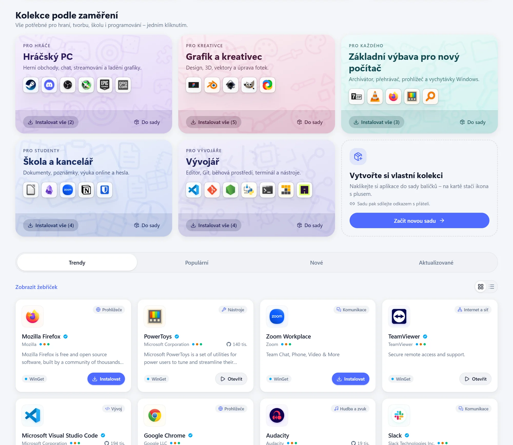
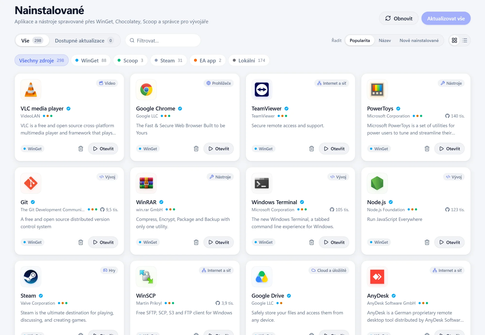

<div align="center">

[English](README.md) · **Čeština**


# HubGet

### Jeden obchod pro všechny aplikace ve Windows

Moderní obchod s aplikacemi pro Windows 10 a 11. Přes **25 000 aplikací** z oficiálních
repozitářů WinGet, Chocolatey a Scoop – instalace jedním kliknutím, bez hledání
instalátorů po webu, bez reklam a přibalených doplňků.

[](LICENSE) [](#stažení) [](https://tauri.app) [](https://react.dev) [](#zdarma-a-open-source)

**[⬇️ Stáhnout pro Windows](https://github.com/matous96/HubGet/releases/latest)** &nbsp;·&nbsp; [🌐 hubget.eu](https://hubget.eu/) &nbsp;·&nbsp; [Prohlídka](#prohlídka) &nbsp;·&nbsp; [Správci balíčků](#správci-balíčků) &nbsp;·&nbsp; [Pro vývojáře](#dokumentace-pro-vývojáře)

<br>

<picture>
  <source media="(prefers-color-scheme: dark)" srcset="assets/readme/cs/okno-tmave.webp">
  
</picture>

Domovská stránka Dnes – tipy, kolekce a Aplikace dne. V sedmi jazycích (čeština, angličtina, němčina, španělština, francouzština, portugalština, čínština), světlý i tmavý motiv podle Windows.

</div>

## Proč HubGet

| 🛡️ Bezpečné – bez virů | ⚡ Jednoduché | 🔄 Vše pod kontrolou |
|:---|:---|:---|
| Jen oficiální repozitáře správců balíčků. Každý instalátor se před spuštěním ověří kontrolním součtem SHA-256. | Jedno kliknutí místo průvodců instalací. Žádné „Další, Další, Dokončit“, přibalené doplňky ani reklamy. | Aktualizace a odinstalace všech aplikací na jednom místě – i těch, které jste nainstalovali dřív a jinak. |

Jedna aplikace = jedna karta. Když je aplikace ve více správcích balíčků, karta ukáže
všechny zdroje i s verzemi a vy si vyberete, odkud instalovat.

## Prohlídka

### Obchod a katalog

Domovská stránka **Dnes** s tipy ze stovek známých aplikací a každý den jinou Aplikací dne,
kategorie, žebříčky a kolekce podle zaměření – pro hráče, kreativce, studenty i vývojáře.
Vyhledávání přes <kbd>Ctrl</kbd>+<kbd>K</kbd> prohledá katalog i živě správce balíčků;
ověřené aplikace jsou ve výsledcích první.

<picture>
  <source media="(prefers-color-scheme: dark)" srcset="website/img/screens/kolekce.webp">
  
</picture>

### Detail aplikace jako v App Storu

Velký banner v barvách ikony aplikace, galerie snímků obrazovky s prohlížečem na celou
obrazovku, co je nového, hodnocení a recenze, ochrana soukromí a odkazy na web, GitHub,
dokumentaci a podporu. Technické údaje: SHA-256, typ instalátoru, systémové požadavky
a závislosti.

Instalace jedním kliknutím z vybraného zdroje, s průběhem stahování přímo v detailu.

<p align="center">
<picture>
  <source media="(prefers-color-scheme: dark)" srcset="assets/readme/cs/stahovani-tmave.webp">
  
</picture>
</p>

### Nainstalované a aktualizace

Přehled všech aplikací v počítači – i programů instalovaných mimo WinGet, aplikací
z Microsoft Storu a her ze Steamu, Epic Games, EA app, GOG, Ubisoft Connect a Battle.net.
Aktualizace jedním tlačítkem **Aktualizovat vše**,
nebo automaticky podle plánu. Selže-li operace kvůli oprávněním, HubGet ji sám zopakuje
s právy správce.

<picture>
  <source media="(prefers-color-scheme: dark)" srcset="website/img/screens/nainstalovane.webp">
  
</picture>

### A k tomu

- 🧹 **Pokročilá odinstalace** – najde zbytky po odinstalaci (AppData, Program Files,
  nabídka Start, registr) a nabídne je smazat; se **sledováním instalace** smaže přesně to,
  co instalátor vytvořil.
- 🚀 **Po spuštění** – programy spouštěné po přihlášení do Windows na jednom místě,
  s vlivem na rychlost startu.
- ⏰ **Aktualizace pod kontrolou** – plán kontrol i instalací, minimální stáří
  aktualizací, výjimky pro baterii, hry a prezentace, instalace jen mimo práci, bod
  obnovení před hromadnou aktualizací a varování, když instalátor přijde z jiného serveru.
- ↩️ **Vrácení aktualizace** – když nová verze nefunguje, jedním kliknutím zpět na tu
  předchozí; vadnou verzi automatické aktualizace přeskočí.
- 🕰️ **Nepoužívané aplikace** – co jste měsíce nespustili (podle záznamů Windows),
  i s hromadnou odinstalací.
- 🔔 **Hlídání aplikací** – zpráva, až vyjde nová verze nebo až aplikace z webu výrobce
  půjde nainstalovat přes HubGet.
- 🖥️ **Moje počítače** – aplikace a čekající aktualizace všech vašich počítačů;
  z jiného počítače sem nainstalujete, co tu chybí.
- 🛡️ **Konec podpory** – upozornění na Python, Node.js, .NET, Javu a další verze, které
  už nedostávají bezpečnostní opravy; i aplikace nainstalované dvakrát.
- 💾 **Velikost na disku** – řazení podle velikosti a kolik místa zabírají nepoužívané aplikace.
- 📊 **Přehled počítače** – kolik aplikací máte a kolik zabírají, největší z nich,
  aplikace spouštěné s Windows, které nepoužíváte, úklid mezipamětí správců balíčků
  a kontrola digitálních podpisů programů.
- ⌨️ **Příkaz `hubget` v terminálu** – `hubget install vlc`, `hubget update`,
  `hubget search …` v příkazovém řádku i PowerShellu; průběh ukáže HubGet.
- 📶 **Jedno procento za celou instalaci** – stahování i instalace v jednom pruhu se
  zbývajícím časem; průběh je vidět i na ikoně v hlavním panelu, pravým tlačítkem na ní
  rychlé akce (Dostupné aktualizace s počtem, Aktualizovat vše, Nainstalované, Hledat, Přehled počítače).
- 🧪 **Vyzkoušet ve Windows Sandboxu** – aplikaci nainstalujete do izolovaných Windows,
  která se po zavření zahodí; do počítače se nic nedostane.
- 💼 **Záloha nastavení před aktualizací** – když aktualizaci vrátíte, vrátí se i nastavení.
- 🔓 **Open-source alternativy** k uzavřeným aplikacím v detailu i v Přehledu počítače.
- 🗂️ **Export pro `winget configure`** – nový počítač (i ve firmě) jedním příkazem.
- 🛡️ **Bezpečnostní aktualizace napřed** – aktualizace, které opravují bezpečnostní chybu,
  mají červený štítek, jsou v seznamu první a nečekají na minimální stáří; u balíčků pro
  vývojáře i známé zranitelnosti z OSV.dev.
- 🔔 **Tlačítka v oznámeních Windows** – Aktualizovat vše, Otevřít nově nainstalovanou
  aplikaci nebo Podrobnosti o chybě rovnou z oznámení.
- 💽 **Offline balíček** – sada aplikací na USB i s instalátory a skriptem `install.cmd`
  pro počítač bez internetu.
- 🏷️ **Odznak „Nainstalovat přes HubGet“** do README vývojářů (detail aplikace → Sdílet).
- 🏢 **Firemní zásady** – zásady skupiny (šablona ADMX) i Intune: povolení správci
  a schválené aplikace, vynucené aktualizace, bez přihlášení.
- 👥 **Spolehlivost verzí od komunity** – dobrovolně a anonymně; verzi, kterou ostatní
  vracejí, automatické aktualizace počkají.
- 🔐 **Nastavení aplikací na nový počítač** – v jednom souboru zašifrovaném heslem.
- 📂 **Čím otevřu tento soubor?** – přetáhněte soubor do okna (nebo hledejte „.psd“)
  a HubGet nabídne aplikace, které ho otevřou.
- 💾 **Hlídání místa na disku** – instalace, na kterou by místo nestačilo, se nespustí
  a HubGet poradí úklid.
- 📜 **Co je nového od vaší verze** – poznámky ke všem vydáním, která aktualizace přeskočí.
- 🩺 **Diagnostika pro podporu** a **stav Windows** v Přehledu počítače (konec podpory,
  čekající restart, místo na disku, body obnovení).
- 🔧 **Opravit aplikaci** – když aplikace nejde spustit nebo hlásí chyby, HubGet obnoví její
  soubory z instalátoru (pravé tlačítko na aplikaci → Opravit).
- 🧽 **Předinstalované aplikace Windows** – Candy Crush, Solitaire, Zprávy, Tipy a další
  odeberete jedním kliknutím v Přehledu počítače; vrátit je jde z Microsoft Storu.
- ⚖️ **Porovnat aplikace** – až čtyři vedle sebe: hodnocení, licence, velikost, podpora
  ARM64, zdroje instalace.
- ♿ **Přístupnost** – velikost textu podle Windows, omezení animací, podtržené odkazy,
  kontrastní motivy Windows a ovládání celé aplikace klávesnicí.
- 📥 **Převzít do správy** – program nainstalovaný z webu výrobce, který je i ve WinGetu,
  převezmete jedním kliknutím a HubGet mu začne nabízet aktualizace; program zůstane, kde je.
- ✨ **Nově v katalogu** – aplikace, které do katalogu přibyly za posledních 7, 30 nebo 90 dní.
- 🔁 **Aplikace, které se aktualizují samy** (Chrome, Steam, Discord…) – jejich aktualizace se
  nepočítají; HubGet je nabídne, jen když se aplikace sama neaktualizuje.
- 🏆 **Nejinstalovanější v HubGetu** – žebříček podle skutečných instalací za 30, 90 a 365 dní
  (dobrovolné anonymní sdílení).
- ✍️ **Ověření podpisu instalátoru** – HubGet ukáže, kdo instalátor podepsal, a když nová verze
  přijde od jiného vydavatele nebo bez podpisu, nespustí ji.
- 🚧 **Opuštěné aplikace** – upozornění na aplikace, které se už nevyvíjejí, s náhradou.
- 🖥️ **Nový počítač** – zaškrtněte aplikace po kategoriích a HubGet je nainstaluje najednou.
- 🔌 **Ovladače z Windows Update** – přehled nabízených ovladačů v Přehledu počítače.
- 🔎 **Hledání podle účelu** – „stříhání videa“, „čtečka PDF“ nebo „rozbalit zip“ najdou
  správné aplikace.
- 💡 **Navržené aplikace a odpovědi vývojářů** – chybějící aplikaci navrhnete a ostatní hlasují;
  vývojáři odpovídají na recenze a vidí statistiky instalací.
- 🎉 **Váš rok s HubGetem** – souhrn instalací, aktualizací a ušetřeného času.
- ☁️ **Dříve nainstalované** – aplikace, které jste už měli (i na ostatních počítačích), mají
  místo Instalovat mráček; v Knihovně je najdete všechny a jde je skrýt.
- 📤 **Uvolnit aplikaci** – odinstaluje ji, ale nastavení nechá; po opětovné instalaci se vrátí.
- ⏸️ **Pozastavit stahování** – stahování instalátoru jde pozastavit a později navázat.
- 🌟 **Významné aktualizace** – nové hlavní verze nainstalovaných aplikací na Domů.
- ⭐ **Výzva k hodnocení** – pár dní po instalaci hodnocení jedním kliknutím.
- 🔁 **Automaticky z ostatních počítačů** – co nainstalujete jinde, nainstaluje se i tady.
- 💡 **Doporučeno pro vás** – „Protože máte OBS…“ podle nainstalovaných aplikací, jen místně.
- 🧪 **Předběžné verze** – u aplikací s Beta, Insiders či Nightly ve WinGetu je vyzkoušíte
  vedle stabilní (jako TestFlight).
- 🐢 **Limit rychlosti stahování** – instalátory nezahltí připojení.
- 💖 **Podpořit vývojáře** – odkazy na GitHub Sponsors, Open Collective, Ko-fi… u open-source aplikací.
- ♻️ **Obnova po přeinstalování Windows** – HubGet pozná počítač podle názvu a vrátí jeho aplikace.
- 🩺 **Proč aktualizace selhala?** – průvodce najde, co ji zastavilo (programy držící soubory, služby,
  restart, místo, manifest), a jedním kliknutím ji opraví a zopakuje.
- 🔁 **Zkusit neúspěšné znovu** – po dávce aktualizací jen ty, které selhaly.
- 🌙 **Po dokončení uspat nebo vypnout** – u Aktualizovat vše, s odpočtem, který jde zrušit.
- 🔑 **Dokončit při příštím přihlášení** – než se spustí aplikace, které aktualizaci blokují.
- 🐞 **Nahlásit chybu v manifestu wingetu** – předvyplněné hlášení do winget-pkgs.
- ⏸️ **Pozastavit automatické aktualizace** na 1, 3 nebo 7 dní (třeba před prezentací).
- 🧭 **Velké verze jen ručně** – nová hlavní verze (OBS 32 → 33) počká na kliknutí.
- 📋 **Přehled před Aktualizovat vše** – co se aktualizuje, z jaké na jakou verzi a kolik se stáhne;
  jednotlivé aplikace jde odškrtnout.
- ⚡ **Stahovat aktualizace předem** – instalátory čekajících aktualizací se stáhnou na pozadí
  a fronta si stahuje dvě další operace dopředu, takže se pak skoro jen instaluje.
- ✅ **Kontrola po aktualizaci** – hlavní program musí být na místě a s platným podpisem,
  jinak varování s radou vrátit předchozí verzi.
- 🖥️ **Aktualizovat i ostatní počítače** – v Moje počítače „Aktualizovat tam“; druhý počítač
  to provede, jakmile na něm HubGet poběží.
- 📲 **Nainstalovat na jiný počítač** – z nabídky u Instalovat; aplikace se nainstaluje, jakmile
  na tom počítači poběží HubGet.
- 🌙 **Nainstalovat později** – v noci, za hodinu nebo ve zvolený čas; do té doby počítač neusne.
- 🧪 **Vyzkoušet na týden** – když aplikaci za týden ani jednou nespustíte, HubGet nabídne ji
  odinstalovat.
- 🕵️ **Soukromí aplikací** – vypnutí telemetrie Firefoxu, Chromu, Edge, VS Code, Office, .NET
  a dalších jejich oficiálními zásadami (Přehled počítače i detail aplikace).
- 🛡️ **Kontrola instalátoru Defenderem** (volitelná) – stažený instalátor před spuštěním celý prověří
  Microsoft Defender; když něco najde, instalace se nespustí.
- ⌨️ **Win+Shift+H** otevře HubGet odkudkoli s kurzorem ve vyhledávání; jednou týdně
  souhrn, co se nainstalovalo a co čeká.
- 📦 **Sady balíčků a profily** – sdílitelná sada aplikací pro nový počítač, export
  pro WinGet i jako skript PowerShellu.
- 💻 **Režim Vývojář** – npm, Bun, pip, Cargo, vcpkg, .NET Tool a PowerShell naostro
  a příkazy pro příkazovou řádku ke zkopírování.
- ⭐ **Komunita** – přihlášení přes GitHub, hodnocení, recenze a aktuální snímky obrazovky
  od uživatelů; synchronizace oblíbených a předvoleb mezi počítači.
- 🌙 **Moderní okno** ve stylu Windows 11, světlý i tmavý motiv, sedm jazyků (čeština, angličtina, němčina, španělština, francouzština, portugalština, čínština); zavřete
  okno a instalace doběhnou na pozadí.

## Správci balíčků

| Správce | Stav | Co umí |
|---|---|---|
| **WinGet** | ✅ plně funkční | hledání, instalace, aktualizace, odinstalace i stažení instalátoru |
| **Chocolatey** | ✅ plně funkční | hledání, instalace, aktualizace a odinstalace; chybějící Chocolatey doinstaluje |
| **Scoop** | ✅ plně funkční | bez práv správce; chybějící Scoop, Git i buckety doplní sám |
| **npm, Bun, pip, Cargo, vcpkg, .NET Tool, PowerShell** | ✅ režim Vývojář | knihovny a nástroje; chybějící Node.js, Python či Rust doinstaluje přes WinGet |

## Stažení

**[Stáhnout nejnovější verzi](https://github.com/matous96/HubGet/releases/latest)** –
instalátor **EXE** instaluje pro aktuálního uživatele bez práv správce, **MSI** se hodí
pro nasazení ve firmách. Požadavky: Windows 10 nebo 11 (64bit) a WebView2, který je ve
Windows předinstalovaný. HubGet se pak aktualizuje sám. Víc na webu:
[hubget.eu](https://hubget.eu/).

> [!NOTE]
> Instalátor zatím není digitálně podepsaný (podpis přes SignPath Foundation
> připravujeme). Edge může hlásit, že se soubor „běžně nestahuje“ (**… → Ponechat →
> Zobrazit další → Přesto ponechat**), a Windows SmartScreen při prvním spuštění zobrazí
> varování (**Další informace → Přesto spustit**).

## Zdarma a open source

HubGet je zdarma, bez reklam a bez telemetrie, pod licencí [MIT](LICENSE). Katalog se
každý den generuje na GitHub Actions, přihlášení, hodnocení a synchronizace běží na
bezplatném tarifu Supabase. Přihlášení je dobrovolné – bez účtu funguje všechno kromě
hodnocení, recenzí a synchronizace.

---

## Dokumentace pro vývojáře

Tauri 2 (Rust) + React 19 + TypeScript + Tailwind CSS v4 + Vite, data pipeline v Node.js.
Rychlý start: `pnpm install` a `pnpm desktop` (podrobnosti níže).

### Více správců balíčků

- `src/services/managers/types.ts` – rozhraní `PackageManager` (stav, instalace
  správce, nainstalované, hledání, operace s průběhem).
- `src/services/managers/sources.ts` – popis zdrojů a sestavení CLI příkazů.
- `src/services/managers/mock.ts` – ukázkové implementace pro vývoj v prohlížeči.
- Katalog (schéma v2) má u každé aplikace pole `sources`
  (`{ source, packageId, version, … }`). Data pipeline páruje balíčky napříč
  repozitáři podle monikeru wingetu, názvu a id – viz [data-pipeline/README.md](data-pipeline/README.md).

### Testy a kontrola

```
pnpm typecheck        # typy aplikace i data pipeline
pnpm test             # testy logiky frontendu (Vitest, src/**/*.test.ts)
cd src-tauri && cargo test && cargo clippy --all-targets
```

Testy frontendu běží v Node bez okna (`vitest.config.ts`, úložiště v paměti –
`src/test/setup.ts`) a hlídají logiku, kde se chyba snadno přehlédne: pravidla aktualizací,
rozpoznání bezpečnostních oprav a dotaz na OSV.dev, alternativy, odhad průběhu, plán úloh,
odkazy `unibox://`, exporty, firemní zásady, spolehlivost verzí, „Čím otevřu“, místo na disku,
poznámky k vydáním, diagnostiku a podporu Windows. Workflow **Kontrola**
(`.github/workflows/checks.yml`) je pouští při každém pushi do main a u pull requestů –
typy a testy frontendu na Ubuntu, `cargo clippy -D warnings` a `cargo test` na Windows.
Testy, které stahují nebo mění stav procesu, jsou `#[ignore]` a spouštějí se ručně
(`cargo test -- --ignored --test-threads=1`).

## Spuštění (webová verze s ukázkovými daty)

Požadavky: Node.js 20+ a pnpm.

```bash
pnpm install
pnpm dev
```

Aplikace poběží na <http://localhost:1420>. Všechny operace (instalace,
aktualizace, odinstalace) se v tomto režimu jen **simulují** – nic se doopravdy
neinstaluje.

Další příkazy:

```bash
pnpm typecheck   # kontrola typů
pnpm build       # produkční build do dist/
```

## Desktopová aplikace (Tauri 2)

Požadavky navíc: Rust (`winget install Rustlang.Rustup`) a Visual Studio Build Tools
s C++ (`winget install Microsoft.VisualStudio.2022.BuildTools --override "--wait --passive
--add Microsoft.VisualStudio.Workload.VCTools --includeRecommended"`). WebView2 je ve
Windows 10/11 předinstalovaný.

```bash
pnpm desktop         # vývoj: Vite + překlad Rustu + okno aplikace (port 1420 musí být volný)
pnpm desktop:build   # instalátory .msi a .exe (NSIS) do src-tauri/target/release/bundle
```

`pnpm desktop` i `pnpm tauri dev` (obal `scripts/tauri.mjs`) spouští jedinou testovací verzi
„HubGet (test)“ s identifikátorem `org.unibox.dev` (`src-tauri/tauri.dev.conf.json`): běží vedle
nainstalovaného HubGetu a má vlastní data (nastavení, přihlášení, oblíbené). Se stejným
identifikátorem by ji ochrana proti druhé instanci hned ukončila a jen přepnula na
nainstalovanou aplikaci (např. po automatickém spuštění Windows). WebView2 má ve vývoji
ladění na `127.0.0.1:9222` (Chrome DevTools Protocol) – automatické testy běží přímo v ní.

Backend je v `src-tauri/` (`src/lib.rs`, příkazy v samostatných modulech). Frontend
pozná desktopový režim funkcí `isTauri()` (`src/lib/tauri.ts`); ve webové verzi se
správci balíčků jen simulují.

#### Správci balíčků v desktopové aplikaci

winget, Chocolatey a Scoop běží naostro: hledání v repozitáři (`choco search`,
manifesty v bucketech Scoopu), verze, instalace, aktualizace, odinstalace a seznam
nainstalovaných. Chybí-li Chocolatey nebo Scoop, HubGet při instalaci z nich nabídne
jejich instalaci na jedno kliknutí oficiálním skriptem (`ManagerSetupDialog` –
Chocolatey s právy správce, Scoop bez nich). Přes kterého správce HubGet aplikaci
nainstaloval, si pamatuje (`store/installedVia.ts`) – štítek „Nainstalováno přes“
a správa sedí i po restartu.

**Správci pro vývojáře** (`src-tauri/src/dev.rs`, `src/services/managers/dev.ts`) – npm,
Bun, pip, Cargo, vcpkg, .NET Tool, PowerShell 7 (PSResourceGet) a Windows PowerShell 5.1
(PowerShellGet) – běží naostro, ale jen v režimu **Vývojář** (`activeSources`
v `store/settings.ts`): běžnému uživateli by do hledání přidali knihovny a zpomalili
seznam nainstalovaných.
- Nástroje se hledají v PATH z registru (nový Node.js či Python je vidět bez restartu
  HubGetu – PATH procesu se doplní) a v obvyklých složkách (`.cargo\bin`, `.bun\bin`,
  `Program Files\nodejs`…); npm se spouští přímo jako `node npm-cli.js`, pip přes
  `py -3 -m pip` / `python -m pip` (ne zástupce Microsoft Storu).
- Nainstalované: `npm ls -g` + `npm outdated -g`, globální balíčky Bunu ze složky
  `~/.bun/install/global`, `pip list` (+ `--outdated`), `cargo install --list`,
  `vcpkg list` + `vcpkg update`, `dotnet tool list --global`, `Get-InstalledPSResource` /
  `Get-InstalledModule`; novější verze u Bunu, Carga a .NET z API registrů (npm,
  crates.io, NuGet) souběžně přes curl.exe.
- Hledání: API registrů npm, crates.io, NuGet (jen nástroje) a PowerShell Gallery;
  PyPI vyhledávací API nemá – přesná shoda názvu; vcpkg `vcpkg search`.
- Operace bez shellu (každý argument zvlášť), PowerShell skriptem; id balíčků a verze
  se ověřují (`valid_id`, `valid_version`) – jiné znaky do příkazu nejdou.
- Chybějící nástroj nainstaluje winget (`dev_setup`: Node.js LTS, Bun, Python 3.13,
  Rustup, .NET SDK 10, PowerShell 7); vcpkg jde nainstalovat jen ručně.
- Kontrola proti nástrojům v počítači (jen čtení):
  `cargo test --lib dev::tests::live -- --ignored --nocapture`.

**Běžící aplikace** (`src-tauri/src/running.rs`, `prepareProcesses` v `store/jobs.ts`):
před instalací, aktualizací a odinstalací HubGet najde procesy aplikace – podle složky
instalace z registru (jistě) a podle složky či souboru pojmenovaného jako aplikace
(`obs-studio`, `Discord.exe` – i bez záznamu v registru). U každého zjistí, jestli má
viditelné okno a jestli je okenní program (hlavička PE):
- proces bez okna, který aplikaci jistě patří (ikona u hodin, proces visící v paměti),
  ukončí bez dotazu – nejdřív slušně, kdo nereaguje, natvrdo – a zapíše to do protokolu
  (vypínač Nastavení → Obecné → Odinstalace a běžící aplikace),
- aplikaci s oknem, konzolový program a proces nalezený jen podle názvu ve výchozím
  stavu zavře bez dotazu s ohledem na neuloženou práci (`closeRunningApp`, backend
  `close_app`): oknům pošle žádost o zavření (jako křížek) a sleduje její okna. Když
  aplikace ukáže nové okno nebo má hlavní okno zablokované modálním dialogem, ptá se na
  uložení práce (Word, grafický editor): natvrdo ji neukončí, karta ukazuje „Čeká na
  zavření aplikace“ a operace pokračuje, až ji uživatel zavře – i když dotaz zruší
  a pracuje dál, čeká se, dokud má hlavní okno (nejvýš 15 minut, pak se operace zruší;
  zrušit jde i křížkem na kartě). Jinak zbytek ukončí natvrdo: aplikaci, která se
  zavřela jen zčásti, schovala se k hodinám (Discord) nebo zamrzla (`IsHungAppWindow`),
  po 3 s; aplikaci, která žádost ignoruje a okno nechá, jak bylo (ChatGPT), po 5 s. Vypínač Nastavení → Obecné → „Zavírat
  běžící aplikace bez dotazu“ (výchozí od 0.2.2; nastavení uložená dřív se jednou
  přepnou na zapnuto). Vypnutý = `AppRunningDialog` – Zavřít a pokračovat / Pokračovat
  bez zavření / Zrušit,
- po odinstalaci ukončí procesy, které z její složky dál běží (složku si backend
  pamatuje z doby před odinstalací), ať nedrží soubory.

Když operace i tak selže s „inUse“ (aplikace naběhla během operace), se zavíráním bez
dotazu ji fronta stejně zavře a operaci jednou zopakuje bez dialogu (`retryAfterClosing`);
teprve když selže i to, nebo se aplikace ptá na uložení práce, `AppInUseDialog` nabídne
aplikaci zavřít a operaci zopakovat.

Soubory aplikace může držet i cizí program – instalátor OBS skončí kódem 6, když má modul
virtuální kamery OBS načtený Edge nebo Claude (jejich služba kamery `video_capture`).
Winget to pozná jen z manifestu (0x8A150111, `inUseByOther`); manifest bez převodu kódu
(OBS 33.0.3) dá obecné „instalátor selhal“ (0x8A150006) – backend pak sám zjistí, jestli
nějaký cizí program má načtené knihovny ze složky aplikace (`running::file_users`, výčet
modulů procesů, ~0,1 s), a chybu přepíše na `inUseByOther` s jeho názvem. Fronta takový
program zavře stejně jako aplikaci (`retryAfterClosing` → `closeRunningApp`; pomocný proces
bez okna natvrdo – okno programu zůstane a službu si spustí znovu) a operaci zopakuje;
neúspěšný první pokus z historie zmizí. Automatická aktualizace na pozadí takto zavře jen
procesy bez okna (vypínač „Ukončit aplikaci běžící na pozadí bez dotazu“), program s oknem nechá být a zkusí
to při příští kontrole. HubGet ani jeho podřízené procesy (WebView2) se nezavírají nikdy
(`own_tree`).

Hledá se i ve sdílených složkách aplikace mimo složku instalace (`related_data_dirs` – složky
v ProgramData a AppData, jejichž název začíná názvem složky instalace: `obs-studio-hook` k
`obs-studio`; hák OBS pro záznam her se načítá i do grafických procesů jiných aplikací, třeba
ASUS Armoury Crate). Pomocné procesy (služba kamery v Edgi / Claude, grafický proces Electronu)
se po ukončení do pár sekund spustí znovu – opakování proto nese `closeFileUsers` a backend je
po celou operaci ukončuje znovu a znovu (`running::HolderWatch`, procesy s oknem vynechá).
Instalátor, který winget po ověření přejmenoval, se při opakování najde podle SHA-256
(`download::reuse_renamed`) – nestahuje se znovu.

**Odložená registrace MSIX** (`package_services.rs`): když balíček používá běžící aplikace (ChatGPT
= balíček OpenAI.Codex se službou Windows, kterou Windows při nasazení samy spustí), winget
registraci odloží („Restart the application to complete the upgrade“) a s vynuceným zavřením ji
nikdy nezkusí. HubGet připravený balíček najde v protokolu nasazení (AppXDeploymentServer, událost
638 „Directly serviced packages“ s nabízenou verzí) a zaregistruje ho s právy správce:
`Add-AppxPackage -DisableDevelopmentMode -ForceApplicationShutdown -Register '…\WindowsApps\<balíček>\AppxManifest.xml'`.
Povýšený pomocník přijme jen přesně tento příkaz a jen pro balíček, který ve WindowsApps leží
(`is_register_command`). Na pozadí (bez UAC) zůstává čekání na restart (`PENDING`).
Automatické aktualizace na pozadí aplikace nezavírají. Obecná slova
(„app“, „client“, „launcher“…) se jako název aplikace nepoužijí – „NVIDIA App“
tak nechytí cizí složku `app`.

**Záložní zdroj instalace:** když instalátor z manifestu wingetu nejde stáhnout
(nefunkční odkaz – HTTP 403/404/410 jako `0x80190194`, nesouhlasí kontrolní součet,
jiné selhání stažení), fronta úloh (`src/store/jobs.ts`) zkusí stejnou aplikaci
u dalších zapnutých a nainstalovaných správců aplikací podle priority z Nastavení
(Chocolatey, Scoop). Každý pokus je v historii operací; když selžou všechny,
uživatel dostane srozumitelnou hlášku s doporučením jiného zdroje.

| Modul (`src-tauri/src/`) | Co dělá |
|---|---|
| `process.rs` | CLI motor: spouštění bez okna konzole, výstup po řádcích (UTF-8, `\r` průběhu, točítko, escape sekvence), zrušení celého stromu procesů |
| `elevation.rs` | „Jako správce“: HubGet spustí sám sebe s `--unibox-elevated` přes UAC; povýšený proces spustí správce balíčků (jen povolené programy) a výstup zapisuje do dočasného souboru, který aplikace průběžně čte |
| `powershell.rs` | Trvale běžící PowerShell pro modul Microsoft.WinGet.Client – výpis nainstalovaných ~0,6 s, hledání ~0,2–1 s (první volání po startu déle) |
| `operations.rs` | Fronta operací (vždy jen jedna instalace najednou), předstažení instalátoru, opakování jako správce, zrušení podle id |
| `download.rs` | Stažení instalátoru přes `curl.exe` s průběhem v procentech a ověřením SHA-256 |
| `progress.rs` | Fáze a procenta operace pro kartu aplikace (posílá je frontendu kanálem) |
| `winget.rs` | Stav, nainstalované, hledání, verze, mezipaměť (`%TEMP%\WinGet`) přes PowerShell modul; instalace / aktualizace / odinstalace / stažení přes winget CLI |
| `choco.rs` | Chocolatey: stav (`choco --version`), nainstalované přenosné balíčky z manifestů `lib\*\*.nuspec` (programy s instalátorem ukazuje winget z registru), dostupné aktualizace (`choco outdated --limit-output`, frontend ho spouští na pozadí a výsledek drží 15 min v `localStorage`), instalace / aktualizace / odinstalace přes choco CLI; ve složce zapisovatelné uživatelem bez povýšení, jinak jako správce |
| `dev.rs` | Správci pro vývojáře (npm, Bun, pip, Cargo, vcpkg, .NET Tool, PowerShell 7 / 5.1): stav, nainstalované s aktualizacemi, hledání v registrech, verze, operace, instalace chybějícího nástroje přes winget |
| `scoop.rs` | Scoop: stav, nainstalované aplikace ze složek `apps\*\current` (novější verze z manifestu v bucketu), instalace / aktualizace / odinstalace / stažení přes `scoop.ps1` (chybějící oficiální bucket přidá) |
| `icons.rs` | Protokol `icon://` (`http://icon.localhost/…`): ikony z internetu i z nainstalovaných EXE s mezipamětí na disku |
| `arp.rs` | Záznamy „Programy a funkce“ (registr Uninstall, HKLM i HKCU) – ověření spustitelného souboru, pozůstatky po odinstalaci, záložní výpis nainstalovaných |
| `disk.rs` | Programy nalezené jen podle složky na disku (Program Files, %LocalAppData%, %AppData%) se zástupcem v nabídce Start |
| `leftovers.rs` | Zbytky po odinstalaci (AppData; s pokročilou odinstalací i Program Files, ProgramData, zástupci a registr), Koš a záloha registru, povýšený úklid |
| `running.rs` | Procesy aplikace (složka instalace, název, okno, GUI/konzole), zavření a ukončení |
| `usage.rs` | Poslední spuštění aplikací (UserAssist), spouštění s Windows, velikost na disku |
| `caches.rs` | Mezipaměti správců balíčků (winget, Chocolatey, Scoop, npm, pip) – velikost a úklid |
| `signatures.rs` | Digitální podpisy hlavních programů aplikací (WinVerifyTrust) |
| `restore.rs` | Bod obnovení systému před hromadnou aktualizací (povýšený pomocník) |
| `shortcut.rs` | Klávesová zkratka Win+Shift+H |
| `cli.rs` | Příkaz `hubget` v terminálu (skript ve WindowsApps, předání příkazu HubGetu) |
| `jumplist.rs` | Rychlé akce na ikoně v hlavním panelu (jump list – zástupci s příkazem `--cli`) |
| `sandbox.rs` | Vyzkoušení aplikace ve Windows Sandboxu (`winget download`, konfigurace .wsb) |
| `settings_backup.rs` | Záloha nastavení aplikace (AppData) před aktualizací a obnovení při vrácení |
| `settings_transfer.rs` | Přenos nastavení aplikací na nový počítač (soubor .hubget-settings, AES-256-GCM + PBKDF2) |
| `offline.rs` | Offline balíček ze sady (`winget download` do vybrané složky, `install.cmd` s tichou instalací) |
| `org_policy.rs` | Firemní zásady z registru (`HKLM\SOFTWARE\Policies\HubGet`, šablona v `policies/`) |
| `startup.rs` | Programy po spuštění (registr Run, složky Po spuštění, plánovač úloh, aplikace ze Storu), zapnutí / vypnutí / odstranění, vliv na start (WDI StartupInfo) |
| `tracker.rs` | Sledování instalace – snímek disku a registru před a po instalaci, záznam pro čisté odinstalování |
| `oauth.rs` | Přihlášení v systémovém prohlížeči – návrat na 127.0.0.1 (RFC 8252) |
| `secure_store.rs` | Šifrované uložení přihlášení (Windows DPAPI) |
| `files.rs` | Uložení exportu přes dialog „Uložit jako“ |
| `apps.rs` | Položky nabídky Start (spuštění aplikace, ikona z EXE), ověření, že spouštěcí soubor existuje |
| `tray.rs` | Ikona v oznamovací oblasti s tečkou stavu operací, zavření okna = běh na pozadí |

- **Předstažení instalátoru:** winget stahuje přes Delivery Optimization, která soubor
  zapisuje až na konci (průběh nejde sledovat) a umí se i na minutu zastavit. HubGet
  proto zjistí instalátor (`winget show`: adresa, SHA-256) a stáhne ho sám přes curl
  tam, kde ho winget hledá (`%TEMP%\WinGet\<id>.<verze>\<sha256>`). winget pak jen
  ověří kontrolní součet a instaluje. Platí pro instalaci, aktualizaci i stažení.
  Když předstažení nejde (Microsoft Store, jiný instalátor), stahuje winget sám
  a procenta se odhadují z rostoucího souboru.
- **Opakování jako správce:** tichá odinstalace MSI nainstalovaného pro všechny
  uživatele bez práv správce končí chybou 1603 (`0x8A150030`). Tyto chyby
  (a „vyžaduje správce“, chyba instalátoru) HubGet automaticky zopakuje s právy
  správce (UAC).
- Aplikace s neznámou nainstalovanou verzí („Unknown“) se mezi aktualizace nepočítají –
  ani po aktualizaci verzi nezískají (stejně jako `winget upgrade` bez `--include-unknown`).
- Výsledek operace se čte z návratového kódu (HRESULT wingetu), ne z textu výstupu –
  winget je lokalizovaný. Kódy se překládají na srozumitelné hlášky (`wingetError.*`),
  „vyžaduje restart“ se oznámí zvlášť.
- Výstup příkazů se zapisuje do Protokolů (šedé řádky), hlášky HubGetu (předstažení,
  opakování jako správce) jako varování.
- **Stav po operaci** (`store/afterOperation.ts`): karta i detail se po instalaci,
  aktualizaci a odinstalaci přepnou hned (optimistická úprava seznamu v cache), pak se
  seznam nainstalovaných a položky nabídky Start (tlačítko Otevřít) ověří u správce
  za 0 / 2,5 / 6 / 12 s – odinstalátory NSIS / MSI a instalátory typu Squirrel dokončují
  práci až po návratu wingetu. Fronta na ověření nečeká a pokračuje další operací.
- Výpis wingetu trvá ~1 s (dřív ~1,8 s): smyčka `foreach` místo `ForEach-Object`,
  `IsUpdateAvailable` jen u balíčků se zdrojem, klíče názvů z registru se počítají jednou.
  Hledání na disku přidá ~0,2 s; zástupce nabídky Start (~0,4 s) načte jen tehdy,
  když na disku něco najde, a minutu je drží v mezipaměti.
  Vyhledávání v katalogu používá předpočítaný index (`catalogSearchIndex`).
- Chybí-li modul Microsoft.WinGet.Client, Nastavení nabídne jeho instalaci
  (PowerShell Gallery, pro aktuálního uživatele).

#### Okno a běh na pozadí

- Okno nemá systémové dekorace (`decorations: false`); vlastní titulková lišta
  (`src/components/layout/TitleBar.tsx`) má zónu pro přetahování
  (`data-tauri-drag-region`, dvojklik = maximalizovat) a tlačítka minimalizace,
  maximalizace a zavření ve stylu Windows 11.
- **Spouštění při startu Windows** (Nastavení → Desktopová aplikace, výchozí vypnuto):
  tauri-plugin-autostart zapíše HubGet do `HKCU\Software\Microsoft\Windows\CurrentVersion\Run`
  s příznakem `--autostart` – po přihlášení se okno neotevře, HubGet běží jen jako ikona
  u hodin (okno se vytváří skryté, `visible: false`, a ukáže se jen při běžném spuštění).
- Zavření okna HubGet jen schová do oznamovací oblasti u hodin (vypnutelné
  v Nastavení → Desktopová aplikace); ikona ukazuje počet aktualizací. Nabídka
  ikony po vzoru UniGetUI: Procházet balíčky, Dostupné aktualizace, Nainstalované
  (ukážou okno na dané stránce – událost `tray-navigate`), Zobrazit HubGet, Ukončit.
  Druhé spuštění HubGetu jen ukáže běžící okno (single instance).
- **Otevřít:** nainstalovanou aplikaci jde spustit z karty i z detailu (`src-tauri/src/apps.rs`,
  `src/lib/launch.ts`). Spustitelné aplikace jsou položky nabídky Start (složka
  `shell:AppsFolder` – klasické programy i aplikace ze Storu; bez odkazů na web,
  dokumentací a odinstalátorů), k aplikaci se najde podle AppID shodného s id wingetu
  (EA app), u programu nalezeného jen na disku podle zástupce do jeho složky, jinak
  podle názvu z katalogu, názvu balíčku a id wingetu. Položky, jejichž spouštěcí soubor
  na disku chybí (pozůstatky po odinstalaci), se vynechají – cíl zástupce
  (`System.Link.TargetParsingPath`) se ověří i u AppID, které cestou není
  (Discord: `com.squirrel.Discord.Discord` → `…\Discord.exe`). Spouští se jako z nabídky Start
  (`explorer shell:AppsFolder\<AppID>`), jen aplikace z aktuálního seznamu.
  Nástroje příkazové řádky bez položky v nabídce Start mají dál „Nainstalováno“.
- **Detekce nainstalovaných** (`winget_installed`) má tři úrovně:
  1. **winget** (`Get-WinGetPackage`) – chyba jednoho zdroje (msstore bez souhlasu,
     výpadek sítě) ani jednoho balíčku výpis neshodí. Každý balíček se spáruje se
     záznamem v registru (klíč `ARP\…`, název nebo poslední část id přesně, částečně
     jen se stejnou verzí) a ověří na disku,
  2. **registr** (HKLM 64/32 bit i HKCU), když výpis wingetu selže (chybí modul,
     jiná verze wingetu) – viditelné záznamy s odinstalací, bez součástí systému
     a aktualizací, se stejnými id jako u wingetu,
  3. **disk** (`disk.rs`) – složky v Program Files, `%LocalAppData%(\Programs)`
     a `%AppData%` s EXE pojmenovaným jako složka, které nezná winget ani registr.
     Počítají se jen se zástupcem v nabídce Start (EA app nechá po odinstalaci
     na disku i EXE) a jen spárované s katalogem; odinstalovat je HubGet neumí.

  **Ověření spustitelnosti** (`arp::presence`): program je nainstalovaný, jen když
  existuje jeho EXE – ne odinstalátor ani aktualizátor (Squirrel `Update.exe`):
  ikona záznamu, EXE ve složce instalace i v podsložkách (Discord `app-<verze>`),
  jinak ve složce odinstalátoru. Pozůstatek (Ollama: zbyly knihovny a záznam) se
  nepočítá. Záznamy, které odinstaluje systémový nástroj (MSI, ovladače NVIDIA přes
  rundll32), ověřit nejde a zůstanou; hry ze Steamu rozhoduje manifest
  `steamapps\appmanifest_<id>.acf`. Ověření jde i lokálně:
  `cargo test arp::tests::survey -- --ignored --nocapture` (a `disk::tests::survey`).

  Ke kartě z katalogu se nainstalovaný balíček přiřadí podle id, u varianty wingetu
  podle základního id (`Google.Chrome.EXE` → karta Google Chrome) a programy, které
  winget zná jen z registru (`ARP\User\X64\Discord`), podle názvu; složka z disku
  i bez hlavní verze nebo podle poslední části id wingetu („EA Desktop“ →
  `ElectronicArts.EADesktop`) (`useInstalledLinks` v `src/hooks/usePackages.ts`).
  Aktualizace, starší verze a příkazy pro příkazový řádek pak míří na skutečně
  nainstalovaný balíček.
- **Ikony (záložní systém, `src/lib/icons.ts`):** pro každou aplikaci se zkouší
  popořadě (1) skutečná ikona nainstalované aplikace z její položky v nabídce Start
  (IShellItemImageFactory – EXE, zástupci i Store; malá ikona v rámečku se ořízne),
  (2) ikona z katalogu (winget, databáze UniGetUI, Chocolatey, web aplikace – vybírá
  datová pipeline) a (3) vygenerovaný avatar s iniciálami na přechodu v barvě
  podle názvu. Favicony se za běhu nehledají – služby Googlu / DuckDuckGo by se
  dozvěděly, které aplikace si uživatel prohlíží. Vše jde přes protokol `icon://` s mezipamětí v
  `%LOCALAPPDATA%\org.unibox.app\icons`: ICO se převede na PNG, prázdné obrázky se
  odmítnou, téměř bílá ikona dostane tmavou dlaždici. Ikona z internetu menší než
  48 px se přeskočí jako nefunkční – všude by byla rozmazaná (katalog takové ikony
  neobsahuje, viz `data-pipeline/README.md`); menší ikona se nezvětší víc než 2×,
  ve velké dlaždici detailu je proto o kousek menší, ale ostrá. Zdroj bez ikony (HTTP 404, 403)
  se den nezkouší; po chybě sítě nebo přetížení serveru (HTTP 429 – Wikimedia
  a Chocolatey omezují počet požadavků – a 5xx) jen 15 minut. Stahuje se nejvýš
  6 ikon najednou.
  Clearbit Logo API už neexistuje a Icons8 vyžaduje klíč, proto je nepoužíváme.
- Ikona v oznamovací oblasti je jednobarevná verze loga (tahy 3 px na mřížce 32 × 32)
  na průhledném pozadí jako systémové ikony: `app.trayIcon` v `tauri.conf.json` →
  `icons/tray.png` (předloha 64 × 64, zdroj `assets/tray-icon.svg`, bílá). Na světlém
  hlavním panelu se přepne na tmavou `icons/tray-dark.png` (`assets/tray-icon-dark.svg`).
  PNG vzniknou příkazem `pnpm tauri icon assets/tray-icon.svg -o <složka> -p 64`
  (soubor `64x64.png`). `tray.rs` předlohu zmenší přesně na velikost ikon v oznamovací
  oblasti (16 px × měřítko Windows – 24 px při 150 %, 32 px při 200 %) a přidá tečku
  stavu operací: modrá = probíhá instalace / aktualizace, červená = chyba, zelená =
  hotovo (`set_tray_status`, stav počítá `hooks/useTrayStatus.ts`; výsledek zmizí po
  otevření okna, případně 10 s poté, co ho uživatel uvidí).
- Banner v detailu a karty na domovské stránce mají barvu podle ikony, kterou
  aplikace opravdu zobrazuje (`src/lib/iconColor.ts`, `hooks/useBrandPalette.ts`):
  nejčastější sytý odstín, černobílá ikona = neutrální. Ručně zvolená barva značky
  z katalogu (`curated.json`) se použije, jen když ji ikona obsahuje (vícebarevná
  loga – Chrome modře, ne náhodně oranžově; GOG se šedou ikonou ne fialově), nebo
  když ikonu nejde načíst. Bez ikony má banner odstín náhradního avataru s iniciálami.
  Text a štítky jsou bílé, kdykoli má bílá proti barvě (ztmavené jako místo s textem)
  kontrast aspoň 2,5 : 1 podle WCAG; tmavé jen na světlých barvách (`isLight` v `lib/color.ts`).

Testy backendu: `cd src-tauri` a `cargo test`.

### Skutečný katalog (data pipeline)

```bash
pnpm pipeline --local
```

Stáhne data z wingetu, Chocolatey a Scoopu (~25 000 aplikací), sestaví
`data-pipeline/out/catalog.json` a zkopíruje ho do `public/catalog.json`,
odkud ho `pnpm dev` načte místo ukázkového katalogu. Podrobnosti v
[data-pipeline/README.md](data-pipeline/README.md).

### Vzdálený katalog

Katalog denně generuje workflow **Katalog** (`.github/workflows/catalog.yml`) na GitHub
Actions a zveřejňuje ho zdarma na GitHub Pages spolu s webem (`website/`):
[hubget.eu/catalog.json](https://hubget.eu/catalog.json),
web na [hubget.eu](https://hubget.eu/). Změna webu
v `main` spustí zveřejnění hned – s posledním zveřejněným katalogem, bez pipeline.
Pages ho posílá komprimovaný (16 MB → ~3,5 MB) a s ETagem – opakované stažení beze
změny je jen odpověď 304. Sestavená aplikace si ho stahuje při startu; jinou adresu
(i pro vývoj, kde se jinak bere místní katalog) nastavíte v `.env.local`:

```
VITE_CATALOG_URL=https://example.com/catalog.json
```

Když stažení selže (offline), použije se místní `public/catalog.json` (při vývoji),
poslední uložená kopie, v sestavené aplikaci `catalog.json` přibalený při sestavení
(z `public/`) a nakonec malý ukázkový `src/data/catalog.sample.json`.

Nastavení (jednou): repozitář → **Settings → Pages → Build and deployment → Source:
GitHub Actions**, pak **Actions → Katalog → Run workflow**. První běh trvá kolem
45 minut (stažení všech zdrojů, ikony z webů aplikací), další díky mezipaměti Actions
pár minut. Před zveřejněním katalog zkontroluje `scripts/check-catalog.mjs` (schéma,
aspoň 10 000 aplikací) a porovná ho se zveřejněným – pokles aplikací nebo ikon o 10 %
a víc ho zastaví (záměrnou změnu pustí ruční spuštění s „povolit_pokles“), takže po
výpadku zdroje zůstane na webu předchozí verze. Výpis z posledního běhu pipeline je na
https://hubget.eu/catalog-report.json. Workflow
**Vydání** přibalí k instalátoru právě zveřejněný katalog.

## Produkční sestavení (instalátor)

```bash
pnpm pipeline --local   # aktuální katalog do public/catalog.json (přibalí se k aplikaci)
pnpm release            # zvýší verzi (0.1.2 → 0.1.3), sestaví a podepíše instalátory
```

Každé sestavení má vlastní číslo verze: `pnpm release` (`scripts/release.mjs`)
nejdřív zvýší poslední číslo verze (`scripts/bump-version.mjs` – `package.json`,
`src-tauri/tauri.conf.json`, `src-tauri/Cargo.toml`), sestaví instalátory s podpisem
pro automatické aktualizace a vytvoří `latest.json`. Jiná verze: `pnpm release 0.2.0`,
poznámky k vydání: `pnpm release -- --notes "Co je nového"`, bez změny verze:
`pnpm release -- --no-bump`. Je-li v prostředí certifikát, instalátory se zároveň
digitálně podepíšou (viz [Podpis kódu](#podpis-kódu-windows-smartscreen)). Sestavení
bez obou podpisů: `npm run tauri build`.

Po sestavení `pnpm release` sám aktualizuje domovskou stránku webu
(`scripts/website-release.mjs`, ručně `pnpm website:release`): číslo verze, názvy
a velikost instalátorů a sekci „To nejlepší z verze“ v češtině i angličtině. Karty
bere z `featured` nejnovějšího vydání v `src/data/changelog.ts` (nadpis, text,
volitelně odkaz), bez nich z prvních dvou bodů `highlights`. Přepisují se jen oblasti
mezi značkami `<!--release:klíč-->` … `<!--/release:klíč-->` na domovské stránce
(`website/index.html`, `website/en/index.html`) a na stránce Správci balíčků
(`spravci.html`, `en/package-managers.html`). Podrobné Novinky a Co chystáme se
generují z dat ve `website/content/` (viz [Úpravy webu v prohlížeči](#úpravy-webu-v-prohlížeči-pages-cms)).
Před vydáním tedy stačí přidat vydání do `changelog.ts` (poznámky v aplikaci
a domovská stránka) a do Novinek v Pages CMS – `pnpm release` upozorní, když
v Novinkách nová verze chybí.

### Úpravy webu v prohlížeči (Pages CMS)

Texty webu se upravují ve formulářích v prohlížeči přes
[Pages CMS](https://pagescms.org) (open source, zdarma) – bez psaní HTML: Novinky
(`novinky.html`, `en/changelog.html`), Co chystáme (`co-chystame.html`,
`en/roadmap.html`) a všechny ostatní texty stránek (viz [Texty stránek](#texty-stránek)):

1. Na [app.pagescms.org](https://app.pagescms.org) se přihlaste přes GitHub.
2. Nainstalujte aplikaci Pages CMS na GitHubu jen pro repozitář `matous96/HubGet`
   (Only select repositories).
3. Otevřete repozitář – v menu jsou **Novinky** (jedna položka na verzi, česky
   i anglicky), **Co chystáme** a **Texty webu – česky / anglicky** (stránka po stránce).
4. Uložení je commit do `main`. Workflow Katalog (běh „Web – aktualizace“) z dat
   vygeneruje stránky a do pár minut je zveřejní.

Texty jsou prosté s malým Markdownem: `**tučně**` a `[odkaz](adresa)` – adresa
`@github` nebo `@releases` vede na repozitář / všechna vydání (`LINKS` ve
`website/main.js`). Nezlomitelné mezery za jednopísmennými předložkami a spojkami
doplní generátor sám. Karty „V kostce“ jsou u vydání (pole V kostce), čipy verzí,
aktuální verze a počet aktualizací (číslem i slovy) se spočítají. Chybí-li anglický
text, anglická stránka ukáže český; vadný záznam se přeskočí s upozorněním u běhu.

Data jsou ve `website/content/` (`novinky/<verze>.json`, `co-chystame.json`),
formulář popisuje `.pages.yml`. Stránky z nich přepíše `scripts/website-content.mjs`
(ručně `pnpm website:content`, spouští ho i `pnpm release` a workflow) – jen oblasti
mezi značkami `<!--obsah:klíč-->` … `<!--/obsah:klíč-->`. Po úpravě v Pages CMS
stáhněte změny (`git pull`), než budete pokračovat v práci lokálně.

#### Texty stránek

Každý text na stránce (nadpisy, odstavce, tlačítka, buňky tabulek, menu…) má
v HTML atribut `data-t` a jeho znění je ve `website/content/texty/<jazyk>/<stránka>.json`
– spolu s titulkem a popisem pro vyhledávače a snímky obrazovky (soubor z knihovny
`website/img` a popis obrázku). Menu, zápatí a hlášky skriptu (`TEXTS` ve
`website/main.js`) jsou společné pro všechny stránky jazyka (`spolecne.json`). Pole
formuláře jsou v pořadí na stránce a popis říká, co text je a v které sekci
(„Odstavec · Proč HubGet“).

Text píšete stejně jako v Novinkách (`**tučně**`, `[odkaz](adresa)`, `` `kód` ``, nový
řádek = zalomení). Ve složených závorkách jsou části stránky, které se ve formuláři
nepíšou: `{ikona}` a `{prvek}` (ikona, obrázek či ozdoba z HTML – zůstane, kde značka
stojí; smazáním zmizí), `{auto:version}` a jiné `{auto:…}` (číslo verze, velikost
instalátoru – doplní se samy), `{ano}` `{ne}` `{částečně}` `{info}` (anglicky `{yes}`
`{no}` `{partly}` `{info}`) – značka ve srovnávací tabulce – a `{→}`. Ojedinělé HTML
s textem (ukázky aplikace na stránce Funkce) zůstává ve formuláři jako HTML.

`scripts/website-texts.mjs` (`pnpm website:content`, spouští ho i `pnpm release`) stránky
a data sladí: novým textům v HTML přidělí `data-t` a přidá je do dat, text upravený
v HTML od posledního commitu převezme do dat (jinak platí data), texty, které ze stránek
zmizely, z dat odebere a přegeneruje formuláře na konci `.pages.yml` (od značky „Texty
stránek“ – ručně se upravuje jen část nad ní). Rozvržení stránek (nové sekce, vzhled) se
dál mění v HTML; po úpravě stačí `pnpm website:content`. Workflow Katalog spouští
`website-texts.mjs --render`, které jen vepíše data do HTML.

Web je rozdělený do podstránek podle horní navigace – domovská stránka nese jen úvod,
novinky, pilíře, rozcestník, „Zdarma“ a stažení:

| Česky | Anglicky | Obsah |
|---|---|---|
| `funkce.html` | `en/features.html` | funkce aplikace, běh na pozadí |
| `spravci.html` | `en/package-managers.html` | co funguje naostro, režim Vývojář a příkazy |
| `srovnani.html` | `en/compare.html` | přehled srovnání (podrobná: `srovnani-*.html`, `en/compare-*.html`) |
| `novinky.html` | `en/changelog.html` | historie změn |
| `co-chystame.html` | `en/roadmap.html` | plány |
| `otazky.html` | `en/faq.html` | časté otázky |

Nová stránka patří do navigace všech stránek (`nav.nav__links`, aktuální s
`aria-current="page"`) a do `website/vite.config.mjs`; `pnpm website:content` jí pak
založí texty a formulář v Pages CMS.

### Vzhled instalátoru (NSIS)

Instalátor `.exe` staví Tauri přes NSIS (Modern UI 2) z vlastní šablony
`src-tauri/nsis/installer.nsi` – kopie výchozí šablony Tauri (tauri-cli v2.12.4)
s beze změny ponechanou logikou instalace; úpravy jsou označené `UNIBOX:`. Při
aktualizaci tauri-cli ji porovnejte s novou výchozí šablonou
(`crates/tauri-bundler/src/bundle/windows/nsis/installer.nsi`).

- `nsis/unibox-ui.nsh` (installerHooks) – písmo Segoe UI 9, barvy designového systému,
  logo vpravo v záhlaví, vlastní texty úvodní a závěrečné obrazovky, průběh bez výpisu,
- `nsis/unibox-pages.nsh` – texty (CZ/EN) a funkce: boční panel i logo v záhlaví se
  zmenšují kvalitně (GDI HALFTONE) přesně na velikost ovládacího prvku, takže jsou
  ostré při jakémkoli zvětšení obrazovky,
- `nsis/sidebar.bmp`, `nsis/header.bmp` – grafika ve vysokém rozlišení, generuje ji
  `powershell -ExecutionPolicy Bypass -File scripts\installer-art.ps1` z geometrie loga,
- jazyk instalátoru se volí podle Windows (čeština, jinak angličtina), ikona odinstalátoru
  je ikona aplikace, místo „Nullsoft Install System“ je dole název a verze.

### Aktualizace HubGetu (auto-updater)

Nainstalovaný HubGet po spuštění (a z nabídky ⋯ / Nastavení) zkontroluje
`latest.json` v GitHub Releases (`plugins.updater.endpoints` v `tauri.conf.json`).
Je-li novější verze, zobrazí dialog „Je k dispozici nová verze HubGetu…“
(Aktualizovat / Později / Přeskočit tuto verzi). Instalátor se po stažení ověří
podpisem – veřejný klíč je v `tauri.conf.json`, soukromý jen u vydavatele – a spustí
se v pasivním režimu; HubGet se pak sám znovu spustí. `requireSignedVersion` brání
podvržení: podpis nese číslo verze, takže starší podepsaný instalátor nejde vydávat
za novou verzi.

Po prvním spuštění nové verze ukáže HubGet dialog **„Co je nového v HubGetu“**
(`WhatsNewDialog`, `store/whatsNew.ts`) s novinkami všech vydání od naposledy
spuštěné verze (nejvýš pět). Verze se ukládá do localStorage a zavřením dialogu
(„Rozumím“) se označí jako zobrazená. Čistá instalace dialog neukazuje. Novinky
vydání se berou ze `src/data/changelog.ts` (česky i anglicky) – **před vydáním do
něj přidejte záznam nové verze**, jinak se dialog neukáže.

Vydání nové verze:

1. `pnpm release` – v `src-tauri/target/release/bundle/nsis/` vznikne instalátor,
   jeho podpis (`.sig`) a `latest.json`.
2. Na GitHubu vytvořte Release se značkou `v<verze>` (např. `v0.2.0`) a nahrajte
   do něj **instalátor** a **latest.json**.
3. Hotovo – nainstalované HubGet si novou verzi najdou samy.

Kolikrát se vydání stáhla, vypíše `pnpm downloads` (`scripts/downloads.mjs`, veřejné
počítadlo GitHubu): instalátor EXE a MSI a `latest.json` – ten si stáhne každá kontrola
aktualizací nainstalovaného HubGetu, takže hrubě ukazuje, kolik kopií běží. GitHub
uvádí jen součty za celou dobu (bez toho, kdo a kdy stahoval) a počítá i vlastní
stažení při testování.

Soukromý klíč je v `%USERPROFILE%\.tauri\unibox-updater.key` (mimo repozitář,
bez hesla; jiné umístění: proměnná `UNIBOX_UPDATER_KEY`). **Zálohujte ho** – bez něj
nejde vydat aktualizaci, kterou by už nainstalované HubGet přijaly. Aktualizace se
hledají ve vydáních repozitáře `matous96/HubGet` (`plugins.updater.endpoints`; verze
do 0.1.22 na staré adrese `matous96/unibox`, kterou GitHub po přejmenování přesměruje –
nový repozitář jménem `unibox` proto nezakládejte). Od 0.1.23 je druhou adresou kopie
`https://hubget.eu/latest.json`: workflow Katalog ji při každém nasazení webu převezme
z posledního zveřejněného vydání a HubGet ji použije, jen když GitHub odpoví chybou
(třeba po dalším přejmenování). Kopie může být až den stará – proto je až druhá; pravost
hlídá podpis, ne adresa.

Výsledek v `src-tauri/target/release/bundle/`:

- `nsis/HubGet_<verze>_x64-setup.exe` – instalátor EXE (instaluje pro aktuálního
  uživatele, bez práv správce; čeština / angličtina),
- `msi/HubGet_<verze>_x64_en-US.msi` – instalátor MSI (pro nasazení ve firmách).

### Podpis kódu (Windows SmartScreen)

Nepodepsaný instalátor Windows označí jako „Neznámý vydavatel“ a SmartScreen při
prvním spuštění zobrazí „Systém Windows ochránil váš počítač“ („Další informace“ →
„Přesto spustit“). Digitální podpis (Authenticode) ukáže vydavatele a soubor pak nejde
nepozorovaně změnit. **SmartScreen ale hodnotí reputaci** podpisu a stahovaného
souboru – i podepsaný instalátor může zpočátku varovat, než si reputaci získá (podle
zkušeností vývojářů to zhruba od roku 2024 platí i pro EV certifikáty). Reputace se
váže k certifikátu: nový nebo obnovený certifikát začíná znovu. Rychlejší cestou je
odeslat podepsaný instalátor Microsoftu k prověření
([Microsoft Security Intelligence](https://www.microsoft.com/wdsi/filesubmission),
volba „Software developer“).

**Podpis při sestavení.** `pnpm release` podepisuje, je-li v prostředí certifikát:
Tauri zavolá `scripts/sign.mjs` (`bundle.windows.signCommand` – předává ho
`scripts/release.mjs`) pro `unibox.exe`, instalátor NSIS, jeho odinstalátor a MSI.
Skript spustí `signtool.exe` z Windows SDK se SHA-256 a časovým razítkem RFC 3161 –
podpis tak zůstane platný i po vypršení certifikátu. Podpis aktualizací (`.sig`) se
pak počítá z už podepsaných instalátorů. Bez certifikátu vznikne nepodepsaný instalátor
a sestavení na to upozorní; nastavený certifikát, který nejde použít (špatné heslo,
chybějící token), sestavení zastaví – nikdy tak nevznikne nepodepsaný instalátor
omylem.

| Proměnná prostředí | Význam |
|---|---|
| `UNIBOX_SIGN_PFX` | soubor `.pfx` s certifikátem a klíčem |
| `UNIBOX_SIGN_PFX_PASSWORD` | heslo k souboru `.pfx` |
| `UNIBOX_SIGN_THUMBPRINT` | místo `.pfx`: otisk (SHA-1) certifikátu v úložišti Windows (Aktuální uživatel → Osobní) – i certifikátu na tokenu nebo v cloudovém HSM, který jeho ovladač do úložiště zpřístupní |
| `UNIBOX_SIGN_TIMESTAMP_URL` | jiný server časového razítka (výchozí `http://timestamp.digicert.com`) |
| `UNIBOX_SIGNTOOL` | cesta k `signtool.exe` (výchozí: nejnovější z Windows SDK, pak `PATH`) |

```powershell
$env:UNIBOX_SIGN_THUMBPRINT = "0123456789ABCDEF0123456789ABCDEF01234567"
pnpm release
```

`signtool.exe` je součástí Windows SDK (Visual Studio Installer → „Windows 11 SDK“).
Jednotlivý soubor podepíše i `node scripts/sign.mjs <soubor>`.

**Vývojový certifikát (vyzkoušení podpisu).**

```bash
pnpm sign:dev-cert
```

`scripts/dev-certificate.mjs` vytvoří self-signed certifikát pro podepisování kódu
`%USERPROFILE%\.tauri\unibox-dev-signing.pfx` (a jeho veřejnou část `.cer`) – do
úložiště certifikátů Windows nic nezapisuje – a vypíše náhodné heslo a příkazy pro
podepsané sestavení (`$env:UNIBOX_SIGN_PFX`, `$env:UNIBOX_SIGN_PFX_PASSWORD`,
`pnpm release -- --no-bump`). Výsledek ověříte ve Vlastnostech souboru → Digitální
podpisy, nebo:

```powershell
Get-AuthenticodeSignature .\src-tauri\target\release\bundle\nsis\Unibox_0.1.11_x64-setup.exe | Format-List
```

Stav `UnknownError` („…ukončen v kořenovém certifikátu, který nemá důvěru…“) je
u vývojového certifikátu v pořádku – Windows mu nedůvěřuje. Na **testovacím**
počítači mu důvěru dát jde (UAC pak ukáže vydavatele „HubGet (dev)“; Windows se
zeptá na potvrzení):

```powershell
Import-Certificate -FilePath "$env:USERPROFILE\.tauri\unibox-dev-signing.cer" -CertStoreLocation Cert:\CurrentUser\Root
```

Odebrání po testu:
`Get-ChildItem Cert:\CurrentUser\Root | Where-Object Subject -like 'CN=HubGet (dev)*' | Remove-Item`.
Na jiných počítačích to nic nezmění a SmartScreen u stažených souborů nevypne –
vývojový certifikát **nikdy nepoužívejte pro distribuci**.

**SmartScreen při lokálním testování.** SmartScreen kontroluje jen soubory označené
jako stažené z internetu (Mark of the Web). Instalátor sestavený na vlastním počítači
značku nemá, takže se u něj SmartScreen vůbec neukáže – s podpisem to nesouvisí.
Testujete-li na svém počítači kopii staženou z GitHubu nebo přenesenou prohlížečem,
značku odstraní `Unblock-File .\HubGet_<verze>_x64-setup.exe` (nebo Vlastnosti souboru →
Odblokovat). Inteligentní řízení aplikací (Smart App Control) ve Windows 11 je samostatná
kontrola – je-li zapnuté, může nepodepsané i self-signed sestavení zablokovat i tak.

**Certifikát pro distribuci** – aby Windows HubGet přestal označovat jako neznámý.
Ceny jsou orientační, ověřte je u vydavatele:

- **SignPath Foundation** – zdarma pro open-source projekty (licence schválená OSI,
  veřejný repozitář, plně automatizované sestavení, např. GitHub Actions). Vydavatelem
  v podpisu je SignPath Foundation a podepisuje se v jejich službě, ne tímto skriptem –
  postup níže.
- **Certum Open Source Code Signing** – levný certifikát pro jednotlivce, kteří vyvíjejí
  open source (orientačně desítky eur ročně). Klíč je v cloudu SimplySign; aplikace
  SimplySign Desktop zpřístupní certifikát v úložišti Windows → `UNIBOX_SIGN_THUMBPRINT`.
- **Běžný OV certifikát** (Certum, Sectigo, SSL.com, DigiCert…) na firmu či jednotlivce.
  Od června 2023 musí být soukromý klíč na hardwarovém tokenu nebo v HSM, takže se
  podepisuje přes `UNIBOX_SIGN_THUMBPRINT` (ovladač tokenu) – soubor `.pfx` se k nim už
  nevydává.
- **Azure Artifact Signing** (dřív Trusted Signing) – kolem 10 USD měsíčně, pro
  jednotlivce ale jen v USA a Kanadě (organizace i z EU). Potřebuje vlastní podepisovací
  nástroj – `scripts/sign.mjs` by se musel rozšířit.

Certifikát ani heslo nepatří do repozitáře (`.gitignore` vynechává `*.pfx`, `*.p12`,
`*.key`); v CI je předávejte jako tajné proměnné.

#### Podpis zdarma: SignPath Foundation + GitHub Actions

Certifikát vydá SignPath Foundation (vydavatel v podpisu „SignPath Foundation“),
podepisuje služba SignPath.io – zdarma pro open source. Sestavení a podpis obstará
workflow `.github/workflows/release.yml`:

1. `tauri build --no-bundle` → `unibox.exe` → SignPath (konfigurace artefaktu `app`),
2. instalátory NSIS a MSI z podepsaného `unibox.exe` (`tauri bundle`) → SignPath
   (konfigurace `installers`),
3. podpis aktualizací (`tauri signer sign --app-version`) z podepsaného instalátoru
   a `latest.json` (`scripts/updater-manifest.mjs`), kontrola podpisů a **koncept**
   GitHub Release.

Verze v podpisu aktualizace je povinná: aplikace má `requireSignedVersion` a podpis
bez ní odmítne (`scripts/check-updater-signature.mjs` to hlídá už při sestavení).
Když zveřejněné vydání aktualizaci kvůli podpisu nenainstaluje, workflow
**Podpis aktualizace** (`.github/workflows/updater-resign.yml`; značka
`resign-v<verze>`, nebo ručně přes Run workflow) instalátor z vydání podepíše znovu
a nahradí `.sig` a `latest.json` – bez nového sestavení.

Každý podpis musí schválit člověk v SignPathu – workflow na schválení čeká (až 2 h
na každý ze dvou kroků). Bez `SIGNPATH_API_TOKEN` workflow sestaví nepodepsané vydání.

Podmínky SignPath Foundation (signpath.org/terms) a co je v projektu připravené:

| Podmínka | Stav |
|---|---|
| Licence schválená OSI, jen open-source součásti | MIT ✓ |
| Veřejný repozitář, sestavení z něj automaticky v CI | [github.com/matous96/HubGet](https://github.com/matous96/HubGet), workflow Vydání ✓ |
| Projekt už vydaný a udržovaný | vydání 0.1.14 a 0.1.15 na GitHubu ✓ |
| Stránka „Code signing policy“ s poděkováním SignPath, rolemi a odkazem na zásady soukromí, odkaz z úvodní stránky a ze stahování | [hubget.eu/podpis-kodu.html](https://hubget.eu/podpis-kodu.html), [en/code-signing.html](https://hubget.eu/en/code-signing.html), role: matous96 ✓ |
| Zásady ochrany soukromí; software, který kontaktuje servery, je ukáže při instalaci a umožní funkce vypnout | `website/soukromi.html`, `website/en/privacy.html` ✓; instalátor NSIS i MSI ukáže před instalací stránku „Ochrana soukromí a licence“ ✓ (`bundle.licenseFile`); kontrolu aktualizací, synchronizaci a přihlášení jde vypnout ✓ |
| Název a verze produktu v souborech (kontrola v konfiguraci artefaktů) | `HubGet` + verze z `tauri.conf.json` ✓ |
| Dvoufázové ověření pro všechny členy týmu na GitHubu i v SignPathu | zapnout |

Postup:

1. Veřejný repozitář: [github.com/matous96/HubGet](https://github.com/matous96/HubGet)
   (adresa je v `plugins.updater.endpoints` v `src-tauri/tauri.conf.json`, v `src/config.ts`
   a v `LINKS` ve `website/main.js`).
2. Vydejte první verzi workflowem bez podpisu (značka `v<verze>`), ať je projekt „vydaný“.
3. Web se zásadami podepisování je zveřejněný na GitHub Pages (workflow Katalog);
   při změně týmu upravte tabulku rolí (`podpis-kodu.html`, `en/code-signing.html`).
4. Požádejte o podpis na [signpath.org/apply](https://signpath.org/apply).
5. Po schválení v SignPathu: **Trusted Build Systems** → přidat GitHub.com a propojit
   s projektem; **Artifact Configurations** → `app` a `installers` z
   `.signpath/artifact-configurations/*.xml`; **Signing Policy** (např. `release-signing`)
   se schvalovateli; uživatel pro CI s oprávněním Submitter a jeho API token.
6. V repozitáři na GitHubu (Settings → Secrets and variables → Actions):
   - Secrets: `SIGNPATH_API_TOKEN`, `TAURI_SIGNING_PRIVATE_KEY` (obsah
     `%USERPROFILE%\.tauri\unibox-updater.key`), `TAURI_SIGNING_PRIVATE_KEY_PASSWORD`,
   - Variables: `SIGNPATH_ORGANIZATION_ID`, `SIGNPATH_PROJECT_SLUG`, `SIGNPATH_POLICY_SLUG`,
     volitelně `VITE_SUPABASE_URL`, `VITE_SUPABASE_KEY`, `VITE_GITHUB_CLIENT_ID`, `VITE_CATALOG_URL`.
7. Vydání: `node scripts/bump-version.mjs`, commit, `git tag v<verze>` a `git push --tags`
   → workflow sestaví → dvakrát schválit v SignPathu → zkontrolovat koncept vydání
   na GitHubu a zveřejnit. Na webu pak změnit text „Instalátor zatím není digitálně
   podepsaný“.

Místní `pnpm release` funguje dál (bez podpisu nebo s vlastním certifikátem).

**Stránka „Ochrana soukromí a licence“ v instalátoru**: text je v
`src-tauri/installer/license.txt` (česky i anglicky, licence MIT). Po změně spusťte
`node scripts/installer-license.mjs` – vytvoří `license.rtf` (WiX bere jen RTF, znaky
mimo ASCII jako `\uN?`), který oba instalátory zobrazí před instalací. Při tiché
automatické aktualizaci se stránka přeskočí.

Vlastní hlášky instalátoru Tauri (přeinstalace / odinstalace, WebView2, zástupce na
ploše…) jsou jen anglicky – český překlad je v `src-tauri/nsis/Czech.nsh`
(`customLanguageFiles` v `tauri.conf.json`). Soubor ukládejte v UTF-8 **bez BOM**,
Tauri ho při sestavení přidá sám (dvojitý BOM makensis odmítne).

## Struktura

```
src/
  app/          router, layout, QueryClient
  pages/        Domů, Kategorie, Detail, Nainstalované, Vyhledávání, Nastavení
  components/   package/ (karty, ikony, průběh), layout/, ui/
  services/     managers/ (winget, Scoop, Chocolatey), catalog.ts, reviews.ts
  store/        Zustand: nastavení, fronta úloh, notifikace
  hooks/        data a motiv
  i18n/         react-i18next, locales/cs.json + en.json
  data/         definice kategorií, ukázkový katalog
```

### Stabilita a odezva

- **Hlavní vlákno okna**: příkazy backendu, které spouštějí procesy, čtou disk
  nebo registr, jsou `async` a práci dělají v `process::background`
  (`spawn_blocking`); synchronní zůstaly jen okamžité (lišta u hodin, šifrované
  úložiště, údaje o systému). Externí programy mají časové limity
  (`process::run`), operace jdou zrušit; protokol ikon je asynchronní.
- **Chyby**: `components/ui/ErrorBoundary.tsx` – spadlá stránka ukáže „Zkusit
  znovu“ / „Domů“ a zbytek okna běží (Layout), vadný dialog jen zmizí, poslední
  záchrana celé aplikace v `main.tsx`. Neošetřené chyby z asynchronního kódu
  zachytí `lib/errors.ts` (oznámení, stejná chyba nejvýš jednou za minutu).
  Selhání správce při výpisu nainstalovaných se oznámí (`getAllInstalled`),
  při hledání ukáže poznámku „Nepodařilo se prohledat…“ – výsledky ostatních
  správců platí dál.
- **Vykreslování**: seznamy po 60 položkách, dočtení s předstihem jako přechod
  Reactu (`startTransition` v `PackageCollection`) – scrollování bez
  zasekávání; výběry z celého katalogu (záložky Domů) přes `topN` místo řazení
  25 000 položek. Měřeno: přechody stránek do 0,4 s, scrollování 144 fps bez
  zahozených snímků, opakované otevírání dialogů bez růstu uzlů a posluchačů.

### Screenshoty

Detail aplikace má galerii snímků obrazovky (`components/package/ScreenshotGallery.tsx`):
karusel se šipkami, tečkami a klávesami ← →, kliknutím prohlížeč na celou obrazovku.
Snímky dodává data pipeline (`screenshots` v katalogu) z komunitní databáze UniGetUI
a z popisů balíčků v Chocolatey – manifesty wingetu ani Scoopu screenshoty nemají.
Zdroj je uvedený u galerie, obrázky se jen odkazují.

### Přihlášení, hodnocení a synchronizace (Supabase)

Hodnocení aplikací 1–5 hvězdičkami: průměr a počet hlasů v detailu a na kartách,
1 přihlášený uživatel = 1 hlas na aplikaci (další hodnocení hlas přepíše).

**Recenze** (`components/package/RatingsSection.tsx`): k hlasu nadpis a text (nejvýš
100 a 2 000 znaků), 1 recenze na aplikaci – jde upravit i smazat (hvězdičky zůstanou).
Veřejné jsou přes funkci `app_reviews()` bez `user_id`, vlastní recenze je první, pak
nejnovější. Jméno autora doplní databáze z přihlášení (GitHub / Google) – jen křestní
jméno, bez něj přezdívka z GitHubu, celé jméno se veřejně neukazuje
(`public_author_name()`, `20261028160000_author_first_name.sql`) – a dialog
upozorní, pod jakým jménem se recenze zveřejní; jméno ani příznak skrytí klient zapsat
nemůže (oprávnění na sloupce). Cizí recenzi jde nahlásit (spam, urážlivá, netýká se
aplikace, jiný důvod) – po 3 nahlášeních se skryje, autor ji vidí dál. Ručně ji skryjete
v Supabase: **Table Editor → ratings → hidden = true**. Ve vývojovém režimu jde sekci
s ukázkovými daty vyzkoušet bez Supabase: v konzoli
`localStorage.setItem("unibox-dev-sample-reviews", "1")` a obnovit okno.
Přihlášení jedním kliknutím přes GitHub nebo Google (OAuth s PKCE v systémovém
prohlížeči, návrat na `http://127.0.0.1:47823/auth/callback` – `src-tauri/src/oauth.rs`).
Relace se ukládá šifrovaně přes Windows DPAPI (`secure_store.rs`), ne do localStorage.
Bez nastaveného Supabase se hodnocení nezobrazuje a přihlášení je jen ukázkové.

**Synchronizace mezi počítači** (Nastavení → Obecné → Synchronizace, `store/sync.ts`):
oblíbené, sada balíčků, předvolby (motiv, barva zvýraznění, jazyk, režim, zobrazení,
zapnutí správci), předvolby oznámení, vzhled aplikací a Moje počítače – každá oblast jde vypnout. Spouští se po
přihlášení, 3 s po změně, při návratu do okna (nejvýš jednou za minutu) a každých
10 minut. Data jsou v tabulce `user_data` (1 řádek = 1 oblast jako JSON, vidí je jen
vlastník – RLS). Slučuje se 3cestně podle stavu po poslední synchronizaci tohoto
počítače (`lib/syncMerge.ts`): změny tady i jinde se spojí, smazané zmizí, při první
synchronizaci vyhrají předvolby z účtu a oblíbené z obou stran zůstanou. Revizi
zvyšuje databáze; když mezi načtením a zápisem zapíše jiný počítač, načte se a sloučí
znovu. **Do účtu nejdou** vlastní argumenty a příkazy instalace (ani u položek sady –
přes účet by je šlo podstrčit všem počítačům), oprávnění, mazání zbytků a plán
automatických aktualizací. „Smazat data z účtu“ data smaže a synchronizaci vypne.
Bez Supabase je „účet“ jen v localStorage tohoto počítače (ukázka, UI to označí).

Nastavení (bezplatný tarif Supabase stačí – Supabase je open source a jde
provozovat i na vlastním serveru; bezplatný projekt se po týdnu bez dotazů uspí –
hlídá to workflow níže, které databázi i zálohuje):

1. Na [supabase.com](https://supabase.com) založte projekt (plán Free). V části **Security**
   nechte **Enable Data API**, vypněte **Automatically expose new tables** (migrace si
   oprávnění nastavují samy – každá nová migrace proto musí mít vlastní `grant`)
   a zapněte **Enable automatic RLS**. Heslo databáze si uložte (zálohy).
2. **SQL Editor** → vložte `supabase/migrations/20261022120000_ratings.sql` → Run
   (tabulka `ratings`, pravidla RLS, veřejná funkce `rating_summaries()`), pak stejně
   `supabase/migrations/20261027120000_user_data.sql` (tabulka `user_data` pro
   synchronizaci, RLS, revize řízená databází) a
   `supabase/migrations/20261027130000_reviews.sql` (text recenzí, jméno autora,
   nahlášení, veřejná funkce `app_reviews()`) a
   `supabase/migrations/20261028120000_app_screenshots.sql` (snímky obrazovky od
   uživatelů, bucket `app-screenshots`) a
   `supabase/migrations/20261028160000_author_first_name.sql` (u recenzí a snímků jen
   křestní jméno nebo přezdívka) a
   `supabase/migrations/20261120120000_update_reports.sql` (spolehlivost verzí od komunity:
   anonymní výsledky aktualizací, funkce `report_update_outcome()` a `update_reliability()`).
   Každý soubor v novém dotazu – dva najednou skončí chybou „already exists“.
3. **Authentication → Sign In / Providers**: zapněte GitHub (a Google). Každý potřebuje
   OAuth aplikaci u poskytovatele (GitHub → Settings → Developer settings → OAuth Apps,
   bez Device Flow – to je jiná aplikace než ta pro publikování; Google Cloud Console →
   Credentials) s návratovou adresou, kterou Supabase u poskytovatele ukáže
   (`https://<projekt>.supabase.co/auth/v1/callback`). Jen s GitHubem nastavte
   `VITE_AUTH_PROVIDERS=github` – aplikace pak tlačítko Google neukáže. Přihlášení
   e-mailem HubGet nepoužívá, poskytovatele **Email** vypněte.
4. **Authentication → URL Configuration → Redirect URLs**: přidejte
   `http://127.0.0.1:47823/auth/callback`, `http://127.0.0.1:47824/auth/callback`,
   `http://127.0.0.1:47825/auth/callback` (desktop) a `http://localhost:1420/**` (vývoj na webu –
   návrat na stránku, ze které se přihlašovalo).
5. Do `.env.local`:
   ```
   VITE_SUPABASE_URL=https://<projekt>.supabase.co
   VITE_SUPABASE_KEY=<publishable key (sb_publishable_…) z Settings → API Keys>
   # volitelně, když není zapnutý Google:
   VITE_AUTH_PROVIDERS=github
   ```
   Veřejný klíč do aplikace patří – data chrání pravidla RLS. Pak `pnpm release`.

Schéma jde ověřit bez Supabase: PGlite (Postgres ve WebAssembly) s náhradou
schématu `auth` – hlasování, RLS, 1 hlas na uživatele, souhrny bez `user_id`;
u synchronizace izolace dat mezi uživateli, revize (zápis se zastaralou revizí nic
nezmění), jen povolené oblasti, limit 256 kB a smazání dat se smazáním účtu;
u recenzí jméno autora z přihlášení (podvrhnout nejde), délky textu, úprava a smazání,
nahlášení (ne vlastní, ne za jiného, jednou) a skrytí po 3 nahlášeních.

#### Snímky obrazovky od uživatelů

Snímky v katalogu pocházejí z komunitních databází a často jsou staré. Přihlášený
uživatel proto může v detailu aplikace přidat aktuální snímky (**Přidat snímek** –
výběr souborů, přetažení nebo Ctrl+V; `components/package/AppScreenshots.tsx`):

- **v aplikaci** se obrázek zmenší (delší strana nejvýš 1 920 px) a zakóduje do WebP
  s náhledem 480 px (`lib/screenshotImage.ts`) – nové zakódování zahodí metadata
  (EXIF, poloha); typický snímek má 100–200 kB, náhled ~15 kB,
- **databáze** (`20261028120000_app_screenshots.sql`) založí záznam: jméno autora
  z přihlášení, cestu `<id>.webp` bez user_id a hlídá limity – 4 snímky k jedné
  aplikaci, 20 na uživatele (`app_screenshot_limits()`),
- **soubory** jdou do soukromého bucketu `app-screenshots` (jen `image/webp` do 1 MB).
  Nahrát jde jen soubor k vlastnímu záznamu a jen jednou, číst přes podepsané adresy
  s platností 1 h jen vlastní a veřejné snímky,
- **zveřejnění**: nový snímek čeká na schválení – autor ho vidí se štítkem „Čeká na
  schválení“, ostatní až po schválení. Snímek si prohlédnete v **Storage →
  app-screenshots** a schválíte v **Table Editor → app_screenshots → approved = true**.
  Bez schvalování: v SQL Editoru
  `create or replace function public.app_screenshot_auto_approve() returns boolean language sql immutable as $$ select true $$;`,
- **moderace**: cizí snímek jde nahlásit (spam, urážlivý, netýká se aplikace, jiný
  důvod), po 3 nahlášeních se skryje; ručně `hidden = true`. Autor svůj snímek smaže
  v prohlížeči snímků (soubory i záznam).

Galerie ukazuje snímky od uživatelů před snímky z katalogu, s autorem a datem.
Po smazání účtu zmizí záznamy a soubory už nikdo nepřečte; dohledáte je v SQL Editoru
a smažete v **Storage → app-screenshots**:

```sql
select o.name, o.created_at from storage.objects o
 where o.bucket_id = 'app-screenshots'
   and not exists (select 1 from public.app_screenshots s where o.name in (s.path, s.thumb_path))
   and o.created_at < now() - interval '1 day';
```

Bezplatný tarif: 1 GB úložiště (tisíce snímků) a přenos 5 GB měsíčně – galerie načítá
plné snímky, náhledy jen v prohlížeči na celou obrazovku a v rozmazaném pozadí.

#### Údržba a zálohy Supabase (GitHub Actions)

Bezplatný projekt se po týdnu bez dotazů do databáze uspí (hodnocení, recenze
a synchronizace pak nefungují, instalace ano) a sám se nezálohuje. Workflow
`.github/workflows/supabase.yml` to řeší zdarma:

- **každý den** pošle do databáze jeden dotaz (`rating_summaries()` pro neexistující
  aplikaci) – podle Supabase stačí pár dotazů denně,
- **každou neděli** udělá zálohu (role, schéma, data včetně účtů – oficiální
  `supabase db dump`), zabalí ji, zašifruje heslem (`scripts/backup-crypt.mjs`:
  scrypt + AES-256-GCM) a uloží jako artefakt běhu na 90 dní. Artefakty veřejného
  repozitáře si může stáhnout kdokoli, proto nešifrovaná data z běhu neodejdou –
  bez hesla (aspoň 20 znaků) se záloha neudělá.

Nastavení (GitHub → **Settings → Secrets and variables → Actions**):

1. **Variables**: `VITE_SUPABASE_URL` a `VITE_SUPABASE_KEY` – stejné hodnoty jako
   v `.env.local` (používá je i vydání).
2. **Secrets → `SUPABASE_DB_URL`**: Supabase → **Connect** → **Session pooler**
   (`postgresql://postgres.<projekt>:<heslo>@aws-0-<oblast>.pooler.supabase.com:5432/postgres`).
   Přímé připojení `db.<projekt>.supabase.co` jde jen přes IPv6, které GitHub Actions
   nemají. Znaky hesla databáze kromě písmen a číslic zapište URL-kódované (`@` → `%40`).
3. **Secrets → `BACKUP_PASSPHRASE`**: dlouhé náhodné heslo (aspoň 20 znaků). Uložte si
   ho i do správce hesel – bez něj zálohu neotevře nikdo, ani vy.
4. **Actions → Supabase → Run workflow** – první záloha a ověření nastavení.

Neúspěšný běh GitHub ohlásí e-mailem. Ve veřejném repozitáři GitHub plánované
workflow vypne po 60 dnech bez aktivity v repozitáři – pak ho zapněte v **Actions →
Supabase → Enable workflow**. Uspaný projekt jde do 90 dnů probudit v Supabase
(**Restore project**), data zůstávají.

Obnova ze zálohy (např. do nového projektu):

1. **Actions → Supabase** → běh → **Artifacts** → stáhnout a rozbalit zip.
2. `pnpm backup:decrypt unibox-supabase-2026-11-01.tar.gz.enc` (zeptá se na heslo),
   pak `tar -xzf unibox-supabase-2026-11-01.tar.gz` → `roles.sql`, `schema.sql`, `data.sql`.
3. Nahrání do databáze postupem Supabase (potřebuje `psql` z PostgreSQL):
   ```
   psql --single-transaction --variable ON_ERROR_STOP=1 --file roles.sql --file schema.sql --command "SET session_replication_role = replica" --file data.sql --dbname "<Session pooler nového projektu>"
   ```
4. U nového projektu znovu kroky 3–5 nastavení výše (přihlášení, adresy, klíč) – má
   jinou adresu i klíč, takže je potřeba i nové vydání aplikace.

Rozšifrované soubory obsahují data uživatelů – po obnově je smažte (`.gitignore`
je pro jistotu ignoruje).

### Publikování aplikací (WinGet)

Vývojáři publikují aplikaci do komunitního open-source repozitáře
[microsoft/winget-pkgs](https://github.com/microsoft/winget-pkgs) – zdarma; HubGet
z něj bere katalog, takže se aplikace po schválení objeví sama. Průvodce
**Publikovat → Vytvořit manifest v HubGetu** (`pages/PublishWingetPage.tsx`, jen desktop):

1. **Instalátor** (`src-tauri/src/publish.rs`): z adresy https ho stáhne do dočasné
   složky (curl), spočítá SHA-256 a velikost, pozná typ (MSI / WiX, MSIX, Inno Setup,
   NSIS, WiX Burn, ZIP, EXE – podle hlavičky a značek v souboru) a architekturu
   (název souboru, jinak hlavička PE; u 32bitových instalátorů Inno / NSIS jen odhad
   k ověření) a přečte název, vydavatele a verzi (informace o verzi EXE, u MSI tabulka
   Property včetně ProductCode). Instalátor se **nespouští** a po analýze se smaže.
2. **Údaje**: předvyplněné z instalátoru (název bez verze a architektury, navržené id
   Vydavatel.Aplikace), doplní se licence, popis, weby, štítky; u EXE přepínače tiché
   instalace (u Inno a NSIS se doplní samy), u ZIP program v archivu.
3. **Kontrola**: údaje podle schématu manifestu 1.9 (`lib/wingetManifest.ts`), pak
   `winget validate` nad vygenerovaným manifestem (3 soubory: version, defaultLocale,
   installer) – náhled, kopírování, uložení do složky.
4. **Odeslání**: pull request do winget-pkgs z účtu vývojáře na GitHubu – přihlášení
   OAuth device flow (kód v prohlížeči, oprávnění `public_repo`, token jen v paměti),
   fork, jeden commit do nové větve a pull request s kontrolním seznamem winget-pkgs.
   HubGet předem ověří, že tahle verze ve WinGetu ještě není.

Přímé odeslání potřebuje client_id bezplatné aplikace GitHub OAuth (bez tajného
klíče – device flow ho nepotřebuje):

1. GitHub → **Settings → Developer settings → OAuth Apps → New OAuth App** (název
   HubGet, web projektu, Authorization callback URL může být web projektu).
2. V nastavení aplikace zapněte **Enable Device Flow**.
3. Do `.env.local`: `VITE_GITHUB_CLIENT_ID=<Client ID>`.

Bez něj průvodce manifest uloží a ukáže, jak ho odeslat nástrojem `wingetcreate`
(open source od Microsoftu) nebo ručně přes GitHub.

### GitHub Stars

U open-source aplikací (odkaz na repozitář na GitHubu) ukazuje detail aktuální počet
hvězdiček z GitHub API (mezipaměť 24 h, bez přihlášení 60 požadavků za hodinu) a karty
číslo z katalogu nebo z mezipaměti. Do katalogu je doplní `pnpm pipeline` – bez tokenu
z deps.dev (Google Open Source Insights, čísla pár dní stará), s proměnnou `GITHUB_TOKEN`
(osobní token bez oprávnění) aktuální čísla z GraphQL API GitHubu.

### Správa aplikací

- **Akce ve vyhledávání** (`components/search/CommandResults.tsx`): Ctrl+K kromě aplikací
  nabídne akce a stránky – „aktual“ → Aktualizovat vše / Zkontrolovat aktualizace,
  „proto“ → Protokoly, „motiv“ → přepnutí režimu, „nast ozn“ → sekce Nastavení. Hledá
  se v názvu akce v jazyce aplikace i v angličtině (začátky slov).
- **Ověřit na VirusTotalu** (Technické údaje, karta SHA-256): odkaz na výsledky antivirů
  pro instalátor s tímto otiskem – nic se nenahrává, VirusTotal soubor hledá podle otisku.
- **Vrácení aktualizace** (`hooks/useRollback.ts`, `components/package/RollbackDialog.tsx`):
  fronta si u aktualizace zapíše do historie verzi před ní (`fromVersion`). Když je
  nainstalovaná novější, detail a kontextová nabídka nabídnou „Vrátit na verzi X“.
  Správci downgrade odmítají (winget „Už je nainstalovaná novější verze“), proto úloha
  s `replaceInstalled` aplikaci nejdřív odinstaluje a pak nainstaluje zvolenou verzi –
  stejně se teď instaluje i starší verze z „Starší verze“. Dialog předem ověří, že správce
  verzi ještě nabízí (jinak vrácení nejde potvrdit); když instalace po odinstalaci přesto
  selže, fronta vrátí aspoň nejnovější verzi, ať aplikace nezůstane odinstalovaná. Po
  úspěšném vrácení (`skipVersion`) vadnou verzi přeskočí připnutí „skip“ (nabídne se až
  novější) a nehlídá se jako „aplikace se vrátila sama“.
- **Hlídané aplikace** (`store/watchlist.ts`, `components/package/WatchlistWatcher.tsx`):
  zvonek v detailu nenainstalované aplikace; po načtení katalogu HubGet oznámí novou
  verzi, nebo že aplikace z webu výrobce (web-only) jde nainstalovat přes správce.
  Seznam je v Oblíbených; nainstalovaná aplikace se přestane hlídat.
- **Nepoužívané aplikace** (Nainstalované → Nepoužívané, `src-tauri/src/usage.rs`,
  `hooks/useAppUsage.ts`): poslední spuštění ze záznamu Windows UserAssist (programy
  a zástupce spuštěné z nabídky Start, hlavního panelu, plochy, Průzkumníka; názvy
  v ROT13, FILETIME). Za používanou se počítá i aplikace, která běží, spouští se po
  přihlášení (klíče Run) nebo má rozšíření kontextové nabídky Průzkumníka (HKCR
  ContextMenuHandlers, ve Windows 11 balíček MSIX „…ShellExtension“ – WinRAR, Mp3tag).
  Nepoužívaná = spustitelná (zástupce v nabídce Start nebo záznam spuštění), 90 dní
  nespuštěná (bez záznamu podle data instalace). Lišta výběru umí hromadnou odinstalaci.
- **Moje počítače** (Nastavení → Moje počítače, `store/devices.ts`,
  `components/settings/DevicesSection.tsx`): každý počítač zapisuje do synchronizace
  (oblast `devices`, klíč = náhodné id počítače) název, Windows, verzi HubGetu a spravované
  aplikace s verzemi; ostatní ukážou počet aplikací a aktualizací a „Nainstalovat sem“
  (dialog importu profilu s aplikacemi, které tu chybí). Po 180 dnech bez ozvání se
  počítač vyřadí. Potřebuje migraci `20261119120000_user_data_devices.sql`.
- **Bod obnovení před hromadnou aktualizací** (Nastavení → Aktualizace balíčků,
  `src-tauri/src/restore.rs`): u ručního „Aktualizovat vše“ (aspoň 2 aplikace) HubGet
  spustí sám sebe s právy správce v pomocném režimu `--unibox-elevated-restore-point`
  a pevným příkazem `Checkpoint-Computer` (z okna jde jen popis, pomocník ho znovu
  ověří). Windows vytvoří nejvýš jeden bod za 24 hodin; s vypnutou Ochranou systému
  žádný – obojí HubGet oznámí a aktualizuje dál.
- **Velikost na disku** (`arp.rs` `estimated_size`, stejný dotaz `app_last_used`): údaj
  EstimatedSize, který o sobě zapisuje instalátor (kB → bajty; u aplikací bez záznamu
  v registru – Store, Scoop – chybí). Nainstalované → Řadit → Velikost, u nepoužívaných
  velikost každé a součet.
- **Konec podpory** (`lib/endOfLife.ts`, `hooks/useEndOfLife.ts`, `components/package/InstalledNotices.tsx`):
  balíček wingetu se převede na produkt a řadu z otevřené databáze endoflife.date
  (Python, Node.js, .NET, Java Temurin / Microsoft / Oracle, PostgreSQL, Go, PHP,
  PowerShell, MySQL, Ruby; API je zdarma a povoluje dotazy z prohlížeče, výsledek se
  drží den). Řada po datu `eol` → panel nad Nainstalovanými a upozornění v detailu
  s nejnovější podporovanou řadou.
- **Nainstalováno dvakrát** (`DuplicatesPanel`): stejný název u balíčků od dvou různých
  zdrojů (správce + původ: WinGet a Scoop, WinGet a Microsoft Store). Dva balíčky téhož
  správce se nehlásí – bývají to potřebné varianty (Visual C++ x86 a x64).
- **Co je nového u aktualizací** (Dostupné aktualizace): poznámky k verzi z katalogu místo
  popisu, jen když patří k nabízené verzi (`latestVersion` = `availableVersion`).
- **Týdenní souhrn** (`components/layout/WeeklySummary.tsx`, Nastavení → Předvolby
  oznámení): jednou za 7 dní (první týden po zapnutí, nejdřív 10 minut po spuštění)
  nainstalované aktualizace a aplikace z historie, čekající aktualizace, čekající na
  oprávnění správce a nepoužívané aplikace; když je všechno nula, nic nepřijde.
- **Klávesová zkratka Win+Shift+H** (`src-tauri/src/shortcut.rs`, plugin
  `tauri-plugin-global-shortcut`, Nastavení → Obecné): zapíná ji frontend podle
  nastavení (`set_global_shortcut`); po stisku backend ukáže okno (i schované u hodin)
  a pošle událost `focus-search` – kurzor do vyhledávání (TopBar). Obsazenou zkratku
  HubGet oznámí.
- **Přehled počítače** (`pages/OverviewPage.tsx`, postranní panel → Knihovna, jen desktop):
  dlaždice z dat, která HubGet už má (nainstalované, velikost podle EstimatedSize,
  aktualizace a kolik jich za 30 dní proběhlo podle historie, nepoužívané, konec podpory,
  nainstalováno dvakrát), největší aplikace a nejdéle nainstalovaná. Dál:
  - **Spouští se s Windows, ale nepoužíváte je** (`usage.rs` příznak `autostart`,
    `useUnusedApps` → `idleAutostart`): zapnutý klíč Run (vypnuté ve StartupApproved se
    nepočítají) aplikace, kterou nikdo 90 dní ručně nespustil – odkaz na Po spuštění. Vynechají se kategorie, které
    pracují na pozadí bez ručního otevření (cloud, zabezpečení, systém, síť, přizpůsobení).
  - **Mezipaměti správců** (`src-tauri/src/caches.rs`, `cache_info` / `clean_cache`):
    stažené instalátory wingetu (`%TEMP%\WinGet`) a Chocolatey (`%TEMP%\chocolatey`),
    mezipaměť Scoopu a staré verze aplikací (kromě aktuální, na kterou ukazuje `current`),
    `npm-cache\_cacache` a mezipaměť pipu. Maže se jen obsah známých složek (nikdy
    složka nad nimi, odkazy se nenásledují); během operací ve frontě je úklid vypnutý.
  - **Kontrola podpisů** (`src-tauri/src/signatures.rs`, `check_signatures`): hlavní
    program aplikace (`arp.rs` `main_executable` – DisplayIcon, jinak EXE v InstallLocation
    pojmenovaný podle aplikace, nebo největší) se ověří přes `WinVerifyTrust` bez kontroly
    odvolání po síti. Výsledek: podepsaný / bez podpisu / neplatný podpis (soubor změněný po podpisu,
    nedůvěryhodný certifikát) / program nenalezen. Spouští se jen na požádání.
- **Příkaz `hubget` v terminálu** (`src-tauri/src/cli.rs`, `components/layout/CliCommands.tsx`,
  Nastavení → Desktopová aplikace, výchozí zapnuto): HubGet zapíše do
  `%LOCALAPPDATA%\Microsoft\WindowsApps` (je v PATH každého uživatele) skript
  `hubget.cmd`, který spustí HubGet s příznakem `--cli`; testovací verze má
  `hubget-test.cmd`. Takové spuštění okno neotevře: připojí se ke konzoli terminálu
  (`AttachConsole`), vypíše nápovědu nebo potvrzení v jazyce Windows a příkaz předá
  HubGetu – spustí ho znovu s `--hubget-cli=<JSON>` (běžící HubGet ho dostane přes
  single-instance, jinak se tím spustí) bez zděděných rukojetí, takže terminál nečeká.
  Frontend příkaz vyzvedne (`take_cli_commands`, událost `hubget-cli`) a provede přes
  frontu operací: `install <aplikace…>` (id z katalogu, `zdroj:balíček`, id balíčku
  – „VideoLAN.VLC“, „vlc“, „firefox“ – nebo přesný název; instaluje hned, protože příkaz
  napsal uživatel sám, a proto jen při jednoznačné shodě – jinak otevře výsledky hledání;
  odkazy z webu jen otevřou seznam), `update [aplikace…]` (bez názvu všechny; podle názvu
  jen jednoznačná shoda mezi nainstalovanými), `search <text>`, `show <aplikace>`, `updates`, `help`, `version`. Cizí
  soubor `hubget.cmd` HubGet nepřepíše; po přesunutí HubGetu skript zapíše znovu.
- **Jedno procento a zbývající čas** (`hooks/useJobPercent.ts`, `lib/phaseEstimate.ts`):
  instalace se stahováním ukazuje jedno procento za obě fáze – stahování vyplní pruh do
  svého podílu (podle toho, jak dlouho obě fáze u balíčku trvaly minule, jinak podle
  velikosti instalátoru; 20–80 %), instalace pokračuje od něj; procento nikdy neklesne
  (víc stahovaných souborů). Bez stahování (instalátor stažený předem) jde instalace od
  nuly. Zbývající čas: stahování podle dosavadní rychlosti + očekávaná instalace, odhadovaná
  fáze podle očekávané délky; pod 3 s se nezobrazuje.
- **Průběh na ikoně v hlavním panelu** (`components/layout/TaskbarProgress.tsx`,
  `setProgressBar`, oprávnění `core:window:allow-set-progress-bar`): stejné procento jako
  karta, žlutě (Paused), když se čeká na uživatele, běžící pruh u neurčitého průběhu.
- **Rychlé akce na ikoně** (`src-tauri/src/jumplist.rs`, `ICustomDestinationList`): zástupci
  na HubGet s `--cli updates` / `update` / `installed` / `search` / `overview` (projdou cestou příkazu
  `hubget`; `search` bez textu dá kurzor do vyhledávání), názvy v jazyce aplikace posílá frontend
  (`set_jump_list`, jen povolené příkazy) – u Dostupných aktualizací s počtem, obnoví se s každou změnou.
- **Vyzkoušet ve Windows Sandboxu** (nabídka u Instalovat, jen WinGet; `src-tauri/src/sandbox.rs`,
  `lib/sandbox.ts`): `winget download` stáhne a ověří instalátor do
  `%LOCALAPPDATA%\<id aplikace>\sandbox`, konfigurace `.wsb` ho připojí do `C:\HubGet`
  jen pro čtení a po přihlášení spustí (MSI přes msiexec, MSIX přes Add-AppxPackage, archiv
  otevře ve Průzkumníku). Bez zapnuté funkce Windows Sandbox (Pro / Enterprise) HubGet poradí,
  jak ji zapnout. Drží se jen poslední stažený instalátor.
- **Záloha nastavení před aktualizací** (`src-tauri/src/settings_backup.rs`, Nastavení →
  Aktualizace balíčků, výchozí zapnuto): před aktualizací se složky aplikace v AppData
  (podle názvu a vydavatele jako u zbytků; ne složky s programem) zkopírují bez mezipamětí
  do `settings-backups\<aplikace>` s verzí v `meta.json`; nad 200 MB se nezálohuje. Po
  úspěšném vrácení aktualizace na tuto verzi se současné složky přesunou do Koše a záloha
  se vrátí. Na každou aplikaci jen poslední záloha; přehled a smazání v Přehledu počítače.
- **Open-source alternativy** (`lib/alternatives.ts`): u uzavřené aplikace (Proprietary,
  Freeware, Shareware…) aplikace s otevřenou licencí ze stejné kategorie podle společných
  štítků (vzácné štítky váží víc; aspoň 2 společné, nejméně polovina nejlepší shody) –
  police v detailu a panel v Přehledu počítače; kurátorské `alternatives` mají přednost.
- **Export pro winget configure** (`buildWingetConfiguration` v `lib/profile.ts`, Nastavení →
  Záloha, Sady balíčků): soubor `.winget` (WinGet Configuration 0.2, zdroj
  `Microsoft.WinGet.DSC/WinGetPackage`) s aplikacemi z wingetu a Microsoft Storu; ověřený
  příkazem `winget configure validate`.
- **Čím otevřu tento soubor?** (`lib/openWith.ts`, `pages/OpenWithPage.tsx` na `/open-with?ext=…`,
  `components/layout/FileDropOpenWith.tsx`): data pipeline bere z manifestů wingetu
  `FileExtensions` (kořen i instalátory, malými písmeny bez tečky, nejvýš 80) do
  `fileExtensions` v katalogu. Soubor přetažený kamkoli do okna (běžné události prohlížeče –
  nativní přetahování Tauri je vypnuté; místa, která soubory přijímají sama, mají přednost)
  otevře stránku s aplikacemi: nainstalované, pak specializované (≤ 12 přípon), pak podle
  popularity. Hledání „.psd“ ukáže odkaz, detail aplikace kartu „Otevírá N typů souborů“.
- **Místo na disku** (`lib/diskSpace.ts`, `system.rs` → `disk_space`): fronta před instalací
  a aktualizací porovná volné místo na systémovém disku s odhadem (instalátor + velikost po
  instalaci, jinak trojnásobek instalátoru + 500 MB rezerva) a operaci nespustí s chybou
  `diskFull` a radou; „Aktualizovat vše“ upozorní předem na celkový nedostatek.
- **Co je nového od vaší verze** (`services/githubReleases.ts`, `components/package/ReleaseHistory.tsx`):
  u aktualizace přes víc vydání a repozitáře na GitHubu vydání mezi nainstalovanou
  a nabízenou verzí (`/repos/{repo}/releases`, bez konceptů a předběžných verzí, číslo verze
  ze značky), Markdown převedený na text, štítek bezpečnostní opravy. Limit GitHub API sdílí
  s hvězdičkami (`BLOCKED_KEY`).
- **Nedávno aktualizováno** (Dostupné aktualizace, `components/package/RecentlyUpdated.tsx`,
  `lib/recentUpdates.ts`): jako v App Storu pod seznamem aktualizací – aplikace, které HubGet
  za posledních 30 dní aktualizoval (ručně i automaticky, z historie operací; u každé jen ta
  poslední) a pořád jsou nainstalované. Aplikace, kterou čeká další aktualizace, tu není – je nahoře
  mezi dostupnými aktualizacemi a po aktualizaci se sem hned přesune. Den („Dnes“, „Včera“,
  pak datum), verze, Otevřít a poznámky z katalogu, pokud patří k verzi, na kterou se
  aktualizovalo.
- **Opravit aplikaci** (nabídka aplikace – pravé tlačítko na kartě, šipka v detailu;
  `lib/repair.ts`, operace `repair` → `winget repair --id … --exact --silent` ve `winget.rs`):
  MSI a MSIX opraví Windows, instalátor EXE winget spustí s parametry opravy z manifestu.
  Jen balíčky wingetu a programy z Aplikací ve Windows (ne hry z obchodů, programy jen na
  disku a rozbalené na ploše). Aplikace pro všechny uživatele se opravuje rovnou jako správce;
  návratové kódy 0x8A150079–7D mají vlastní hlášky (oprava nepodporovaná, selhala, rozsah).
- **Hry ze všech obchodů** (`games.rs`, `ArpEntry::game_store` v `arp.rs`, `GAME_STORES`
  v `services/managers/sources.ts`): vedle Steamu i EA app, GOG (`goggame-*.info` ve složce
  hry), Ubisoft Connect (klíč `Uplay Install <číslo>`, spuštění `uplay://launch/<číslo>/0`),
  Battle.net (odinstalátor Battle.net) a Epic Games – ty v registru nejsou, najdou se
  v manifestech `…\EpicGamesLauncher\Data\Manifests\*.item` (bez DLC a rozpracovaných
  instalací) s id `EPIC\<AppName>` a spouští je Epic (`com.epicgames.launcher://apps/…`).
  Hry aktualizuje jejich spouštěč; hru z Epicu HubGet ani neodinstaluje.
- **Předinstalované aplikace Windows** (Přehled počítače; `preinstalled.rs`,
  `components/home/PreinstalledPanel.tsx`, `store/preinstalled.ts`): pevný seznam bezpečně
  odebratelných balíčků (hry, Zprávy, Počasí, Tipy, aplikace partnerů – žádné součásti Windows,
  Store, winget ani Herní panel), názvy v jazyce systému přes WinRT `PackageManager`. Odebere
  vybrané jen aktuálnímu uživateli (`Remove-AppxPackage` ve vlastním procesu PowerShellu, bez
  práv správce), zapíše je do Historie a nabídne vrácení přes stránku v Microsoft Storu
  (`ms-windows-store://pdp/?PFN=…`). „Vybrat doporučené“ vybere jen ukončené a reklamní aplikace.
- **Porovnat aplikace** (`pages/ComparePage.tsx` na `/compare`, `lib/compare.ts`,
  `store/compare.ts`, `components/layout/CompareBar.tsx`): až 4 aplikace z katalogu vedle sebe
  v tabulce (hodnocení, licence, verze a vydání, velikost instalátoru a na disku, ARM64,
  minimální Windows, zdroje, hvězdy na GitHubu, odkazy); nejlepší hodnota v řádku je
  vyznačená, jen když jasně vede. Přidání z nabídky aplikace, z lišty hromadného výběru
  (2–4 aplikace) nebo hledáním na stránce.
- **Přístupnost** (Nastavení → Vzhled → Přístupnost; `hooks/useAccessibility.ts`,
  `components/settings/AccessibilityCard.tsx`, `system.rs` → `text_scale_factor`): velikost
  textu podle Windows (Velikost textu – WebView2 ji sám neuplatní) nebo vlastní 90–150 %
  (na desktopu zoom WebView2, takže se přeskládá i rozvržení), omezení animací (třída
  `reduce-motion` a `MotionConfig`), podtržené odkazy, „Přeskočit na obsah“ pro klávesnici
  a styly pro kontrastní motivy Windows (`@media (forced-colors: active)` v `styles/index.css`).
- **Převzít do správy** (Nainstalované → panel nad seznamem, detail aplikace; `lib/adopt.ts`,
  `store/adopted.ts`, `components/package/AdoptPanel.tsx`): program mimo správce (štítek
  Lokální) spárovaný podle názvu s aplikací z katalogu, která má balíček wingetu. Po převzetí
  se vede pod id balíčku (`withAdoptedPackages` v `hooks/usePackages.ts`, původní id
  v `adoptedFrom`), novější verze v katalogu se nabídne jako aktualizace a fronta úloh ji spustí
  jako instalaci nové verze přes winget (`adoptedRequest` v `store/jobs.ts` – `winget upgrade`
  by program nenašel); odinstalace a oprava jdou přes původní záznam ve Windows. V počítači
  převzetí nic nemění; zrušit jde v detailu aplikace.
- **Nově v katalogu** (`pages/NewPage.tsx` na `/new`, levý panel → Objevovat): aplikace podle
  `addedAt` z data pipeline za 7, 30 nebo 90 dní, s dnem přidání; upozorní, od kdy katalog
  nové aplikace sleduje. Záložka Nové na Domů odkazuje sem.
- **Aplikace, které se aktualizují samy** (`data/selfUpdating.ts`, pravidlo v
  `store/updateRules.ts`, Nastavení → Aktualizace balíčků): známé aplikace s vlastním
  aktualizátorem (prohlížeče, komunikátory, herní obchody…) i nainstalované přes jiného
  správce (stejný profil v katalogu). Jejich aktualizace se nepočítají (zámek `self` s datem)
  a nabídnou se až po 14 dnech od vydání, bezpečnostní oprava po 3 dnech; „Nabídnout znovu“
  v detailu je nabídne hned (`selfOffer` v `store/updateHolds.ts`).
- **Nejinstalovanější v HubGetu** (Nejstahovanější → řazení; `store/installStats.ts`,
  Supabase `20261121120000_install_reports.sql`): dobrovolné anonymní hlášení úspěšné instalace
  aplikace z katalogu (jen id aplikace a náhodné id instalace HubGetu, nejvýš 200 za den)
  a žebříček za 30, 90 nebo 365 dní z funkce `install_ranking` (aplikace od 3 instalací).
  Instalace za rok přidají výchozí popularitě až 15 bodů (`usePopularityBoost` – Nejstahovanější
  a záložka Populární na Domů).
- **Ověření podpisu instalátoru** (`signatures.rs` → `installer_signature`, `signer_verdict`,
  `store/signers.ts`): instalátor, který HubGet stáhl předem (winget), se před spuštěním ověří
  přes Get-AuthenticodeSignature. Vydavatel se zapamatuje a při další instalaci či aktualizaci
  musí sedět – jiný vydavatel, chybějící podpis (dříve podepsaný) nebo podpis neodpovídající
  obsahu instalaci zastaví (`signerChanged`, `signatureMissing`, `signatureInvalid`). Změnu jde
  přijmout v detailu aplikace („Důvěřovat a aktualizovat“). Chocolatey a Scoop ani balíčky ze
  Storu se nekontrolují (instalátor stahuje správce sám).
- **Opuštěné aplikace** (`lib/abandoned.ts`, `components/package/AbandonedNotice.tsx`): archivovaný
  repozitář na GitHubu, 2 roky bez změn (`archived`, `lastCommit` – data pipeline, GraphQL
  `isArchived`, `pushedAt` v `sources/github.ts`), bez GitHubu poslední verze starší 3 let;
  s open-source náhradami, které se samy vyvíjejí. Hry se vynechávají.
- **Nový počítač** (`pages/NewPcPage.tsx` na `/new-pc`, `data/newPc.ts`): oblíbené aplikace po
  kategoriích k zaškrtnutí, instalace najednou přes frontu úloh nebo uložení jako sada.
- **Ovladače z Windows Update** (Přehled počítače; `drivers.rs`, `components/home/DriversPanel.tsx`):
  hledání `IsInstalled=0 and Type='Driver'` přes COM Microsoft.Update.Session ve vlastním procesu
  PowerShellu; instalaci předá Volitelným aktualizacím ve Windows Update.
- **Hledání podle účelu česky** (`lib/searchIntents.ts`): kmeny českých výrazů → anglické výrazy
  v popisu, štítcích a názvu; výsledky pod přímými shodami.
- **Navržené aplikace, odpovědi vývojářů a statistiky** (Supabase
  `20261122120000_community.sql`, `services/community.ts`, `pages/RequestsPage.tsx` na `/requests`,
  `components/package/DeveloperReplies.tsx`, `components/publish/DeveloperStats.tsx`): návrhy
  s hlasováním (nejvýš 5 za den, stejný název = hlas), odpovědi pod recenzemi jen pro vývojáře
  schválené správcem HubGetu (žádost s účtem GitHub a repozitářem, schválení SQL příkazem
  z migrace) a počty instalací jedné aplikace za 30, 90 a 365 dní (méně než 3 = neukazuje se).
- **Váš rok s HubGetem** (`pages/YearPage.tsx` na `/year`, `store/yearStats.ts`, odkaz z Historie):
  průběžné počty operací po letech (historie drží jen 500 záznamů), nejčastěji aktualizované
  aplikace, měsíce a odhad ušetřeného času; jen místně.
- **Dříve nainstalované** (`pages/PreviousPage.tsx` na `/previous`, `store/everInstalled.ts`): každá
  aplikace z katalogu, kterou HubGet viděl nainstalovanou (PackageIndexSync), a jednou i aplikace
  z historie operací (instalace, aktualizace, oprava, odinstalace); `elsewhere` = aplikace z ostatních
  počítačů na účtu (Moje počítače). Nenainstalovaná aplikace, která tu (nebo jinde) byla, má
  v `PackageAction` mráček – v seznamech jen ikona široká jako tlačítko Instalovat, v detailu
  „Nainstalovat znovu“. Skryté položky (`hidden`); Vymazat historii zapomene vše kromě nainstalovaných.
- **Uvolnit aplikaci** (nabídka nainstalované aplikace; `store/offloaded.ts`, `Job.offload`):
  před odinstalací se nastavení zálohuje vždy (`settings_backup`, i s vypnutou zálohou před
  aktualizací), zbytky se nenabízejí ke smazání; po úspěšné instalaci téže aplikace
  `restoreOffloaded` vrátí zálohu (`settings_restore`) a záznam smaže.
- **Pozastavit stahování** (`operations.rs` → `pause_operation`, `download.rs`, `store/pausedJobs.ts`):
  jen když instalátor stahuje HubGet sám (předstažení wingetu – událost `pausable`). Pozastavení
  ukončí curl a nechá `.unibox-part`; operace skončí jako `cancelled` s klíčem `paused`, úloha
  čeká mimo frontu (fronta pokračuje). Pokračovat ji zařadí znovu a curl naváže
  (`--continue-at -`; curl pak hlásí procenta jen ze zbytku – `overall_percent` přičte
  stažené); server bez navázání (curl 33) = celý soubor znovu. Zrušení rozstažený soubor smaže.
- **Významné aktualizace** (`lib/majorUpdate.ts`, `components/home/MajorUpdates.tsx`): nová hlavní
  verze (první číslo verze; rok a sestavení ≥ 1000 se nepočítají) – karty na Domů s první větou
  poznámek k vydání, štítek v seznamu aktualizací a v Co je nového.
- **Výzva k hodnocení** (`components/home/RatePrompt.tsx`, `lib/ratePrompt.ts`, `store/ratePrompts.ts`):
  instalace přes HubGet starší 3 dnů a mladší 60 dnů, aplikace je pořád nainstalovaná a není
  ohodnocená; nejvýš jedna výzva denně, „Neptat se“ (zpět v Nastavení → Aktualizace balíčků).
- **Automaticky z ostatních počítačů** (Nastavení → Moje počítače; `DeviceAutoInstaller`,
  `store/deviceInstalls.ts`): aplikace, která na jiném počítači přibyla po zapnutí (výchozí stav
  se při zapnutí i u nového počítače jen zapamatuje), se nainstaluje na pozadí – přes stejného
  správce, jinak přes jiný zapnutý zdroj; ne aplikace, kterou tu uživatel odinstaloval. Na měřeném
  připojení (volba „přeskočit na měřeném připojení“ automatických aktualizací) počká.
- **Doporučeno pro vás** (`components/home/ForYou.tsx`, `lib/recommendations.ts`): výchozí aplikace
  = nainstalované přes HubGet (nejnovější první), pak ostatní nainstalované podle popularity; každá
  kategorie jen jednou (bez Systém), kandidáti ze stejné hlavní kategorie – víc společných štítků,
  pak popularita; bez nainstalovaných a dřív nainstalovaných (`everInstalled`). Jen místně.
- **Předběžné verze** (`lib/channels.ts`, `components/package/ChannelLinks.tsx`): samostatné balíčky
  WinGetu s příponou id (`.Beta`, `.Insiders`, `.Nightly`, `.Canary`, `.PTB`…) – stabilní detail
  nabídne kanály, detail předběžné verze upozorní a odkáže na stabilní.
- **Limit rychlosti stahování** (Nastavení → Aktualizace balíčků; `downloadLimit` v
  `store/autoUpdates.ts`, `DownloadLimitSync` → `set_download_limit`): curl předstažení dostane
  `--limit-rate`; instalátory, které stahuje správce sám, omezení nemají.
- **Podpořit vývojáře** (`components/package/FundingButton.tsx`, `lib/funding.ts`,
  `services/funding.ts`): odkazy z katalogu (data pipeline – GraphQL `fundingLinks`, pole `funding`),
  jinak živě z FUNDING.yml na raw.githubusercontent.com (`.github/FUNDING.yml`, `FUNDING.yml`,
  repozitář `.github` vlastníka); vlastní adresy jen http(s).
- **Obnova po přeinstalování Windows** (`components/home/RestoreFromDevice.tsx`): záznam jiného
  počítače se stejným názvem jako tento (Moje počítače) a aspoň 5 aplikací, které tu chybí –
  nabídka na Domů otevře dialog importu profilu (`deviceMissingApps`); zavřená se u záznamu
  neukáže (`dismissedRestore`).
- **Výzva k hodnocení → recenze**: po hodnocení z výzvy nabídka „Napsat recenzi“ – detail
  s `?review=write` otevře psaní recenze (`RatingsSection`).
- **Proč aktualizace selhala?** (Historie operací → u chyby; `components/package/UpdateDoctorDialog.tsx`):
  `app_blockers` (running.rs) spojí načtené knihovny (`file_users`) s Restart Managerem
  (`RmGetList` nad DLL/EXE ze složek aplikace, nejvýš 3000 souborů – vidí i služby a otevřené
  soubory), k tomu běžící aplikace, čekající restart (`windows_health`) a klíč chyby z historie
  (`errorKey`): připojení, místo, práva správce, podpis, manifest. „Opravit a zkusit znovu“ zavře,
  co jde (`closeApp`), a operaci zařadí s `closeFileUsers` (u práv správce i `asAdmin`).
- **Zkusit neúspěšné znovu** (`FailedRetryBanner`, `useFailedBatch`): fronta si v dávce pamatuje
  neúspěšné operace spuštěné uživatelem; na konci dávky nabídka nad aktualizacemi a v historii.
- **Po dokončení uspat / vypnout** (`AfterBatchSelect`, `PowerCountdownDialog`, `power_action`):
  volba platí pro jednu dávku; po doběhnutí fronty odpočet 60 s (jde zrušit), pak
  `SetSuspendState` nebo `shutdown /s /t 0`.
- **Dokončit při příštím přihlášení** (`useDeferredUpdates` – ukládá se, `DeferredUpdatesRunner`,
  `session_info`): odložené operace se po načtení nainstalovaných aplikací zařadí, když HubGet
  spustily Windows (`--autostart`) nebo když se od odložení změnil čas startu počítače.
- **Nahlásit chybu v manifestu** (`lib/manifestIssue.ts`): u chyb, za které nejspíš může manifest
  (odkaz, součet, neznámý kód instalátoru), odkaz na nové hlášení v microsoft/winget-pkgs
  s předvyplněným nadpisem a textem podle šablony Package Issue (bez osobních údajů); odeslání
  je na uživateli.
- **Pozastavit automatické aktualizace** (Nastavení → Aktualizace balíčků; `pausedUntil`
  v `store/autoUpdates.ts`): do zvoleného času `useAutoUpdates` nic nezařadí (jen záznam
  v protokolu), kontrola a oznámení běží dál; „Obnovit“ pauzu zruší.
- **Velké verze jen ručně** (`majorManual`, výchozí zapnuto; `lib/majorUpdate.ts`): automatické
  aktualizace vynechají změnu hlavní verze (`isMajorUpdate`) a jednou za běh to zapíšou do protokolu.
- **Přehled před Aktualizovat vše** (`components/package/UpdatesOverviewDialog.tsx`,
  `overviewBeforeUpdateAll`): bezpečnostní a velké aktualizace první, velikost instalátoru ze
  zdroje, přes který je aplikace nainstalovaná, a první věta novinek; „Příště neukazovat“ volbu vypne.
- **Stahovat dopředu** (`prefetch_ahead` / `cancel_prefetch_ahead` ve winget.rs, `prefetchQueued`
  v `store/jobs.ts`): fronta stáhne instalátory dalších dvou čekajících operací současně s během
  aktuální (`IN_FLIGHT` v operations.rs zabrání dvojímu stahování téhož souboru); zrušení operace
  ve frontě stahování zastaví. `UpdatePrefetcher` (`prefetchUpdates`) mimo frontu a ne na
  měřeném připojení stáhne předem instalátory všech čekajících aktualizací z wingetu.
- **Kontrola po aktualizaci** (`checkAfterUpdate` v `store/jobs.ts`): před aktualizací
  `check_signatures` zjistí hlavní program aplikace a jeho podpis; 15 s po úspěchu se porovná –
  chybějící soubor, neplatný podpis nebo ztracený podpis dají oznámení s radou vrátit verzi.
- **Aktualizovat tam** (Moje počítače; `store/devices.ts`): žádost `{ id, target, kind: "updateAll" }`
  jde do záznamu počítače, který žádá (každý počítač píše jen do svého, platí 7 dní);
  `DeviceCommandRunner` na cílovém počítači ji po načtení nainstalovaných aplikací vyřídí jednou
  (`handled`) jako Aktualizovat vše a obnoví „naposledy vidět“, aby žádající počítač viděl, že
  došla. Tlačítko se nabídne jen počítačům, které žádosti umí (`accepts`, starší HubGet ne).
- **Nainstalovat na jiný počítač** (nabídka instalace; `components/package/SendToDeviceDialog.tsx`):
  žádost `{ kind: "install", app: { appId, name, source, packageId } }` stejnou cestou jako Aktualizovat
  tam (stejná aplikace pro stejný počítač nahradí předchozí, nejvýš 20 žádostí). Cílový počítač ji
  nainstaluje přes stejného správce, jinak přes jiný zapnutý zdroj z katalogu (`pickSource`); co tam
  už je, jen zapíše do protokolu. Synchronizace přijme jen známé druhy a platnou aplikaci (`syncKinds.ts`).
- **Nainstalovat později** (`store/scheduled.ts`, `components/package/ScheduleInstall.tsx`): v noci
  (nejbližší 2:00), za hodinu nebo vlastní čas; `ScheduledInstallsRunner` kontroluje každých 30 s
  a dokud nějaká instalace čeká, `keep_awake` (system.rs) drží `SetThreadExecutionState` ve vlastním
  vlákně – počítač sám neusne. Propásnutý čas (vypnutý počítač) se doplní po spuštění HubGetu.
- **Vyzkoušet na týden** (`store/trials.ts`, `components/home/TrialPrompt.tsx`): po 7 dnech
  `TrialWatcher` zjistí z `app_last_used` (UserAssist), jestli se aplikace od začátku zkoušky
  spustila (nebo právě běží) – pak zůstane bez ptaní, jinak nabídka Ponechat / Odinstalovat na Domů.
- **Soukromí aplikací** (`src-tauri/src/privacy.rs`, `lib/privacy.ts`, `components/home/PrivacyPanel.tsx`):
  jen zdokumentované zásady výrobců – Firefox / Thunderbird `DisableTelemetry`, Chrome
  `MetricsReportingEnabled`, Edge `DiagnosticData`, Brave (i P3A a statistický ping), VS Code
  `TelemetryLevel`, Visual Studio SQM, Office `SendTelemetry`, proměnné `DOTNET_CLI_TELEMETRY_OPTOUT`
  a `POWERSHELL_TELEMETRY_OPTOUT`. Uživatelské zapíše HubGet sám (proměnné rozešle `WM_SETTINGCHANGE`),
  zásady v HKLM přes PowerShell jako správce – povýšit jde jen skript přesně podle seznamu
  (`is_policy_command`). Vrácení smaže jen hodnoty HubGetu, ne celý klíč.
- **Kontrola instalátoru Defenderem** (`src-tauri/src/defender.rs`, Nastavení → Aktualizace balíčků,
  výchozí vypnuto – vlastní sken rozbalí celý archiv, 774MB MSIX trvá asi 2,5 min; jde zrušit):
  po stažení a ověření podpisu `MpCmdRun -Scan -ScanType 3 -File … -DisableRemediation` (bez práv
  správce); kód 2 = hrozba → chyba `threatFound` s názvem hrozby, jiný kód (jiný antivirus) jen
  zápis do protokolu. Průběh ukazuje fázi „Kontrola Defenderem“.
- **Diagnostika pro podporu** (Nastavení → Kontaktovat HubGet; `lib/diagnostics.ts`,
  `components/settings/DiagnosticsCard.tsx`): verze, správci, disk, nastavení, firemní
  zásady, posledních 30 neúspěšných operací a 300 řádků protokolu do souboru nebo schránky;
  `redact()` nahradí cesty k profilu, e-maily a jméno počítače.
- **Stav Windows** (Přehled počítače; `components/home/WindowsHealthPanel.tsx`,
  `lib/windowsSupport.ts`, `system.rs` → `windows_health`): podpora verze Windows podle
  endoflife.date (řada podle sestavení a edice – W / E / LTSC / IoT), čekající restart
  (klíče `RebootRequired` a `RebootPending`), doba od spuštění, místo na disku a ochrana
  systému (`RPSessionInterval`).
- **Bezpečnostní aktualizace** (`lib/securityUpdates.ts`, `hooks/useSecurityUpdates.ts`): verze,
  jejíž poznámky z katalogu mluví o CVE, GHSA, „security fix“ nebo opravené zranitelnosti
  (jen jednoznačné obraty – nástroje pro audit mají „vulnerability“ i v popisu funkcí), má
  červený štítek na kartě, v Co je nového a v Dostupných aktualizacích (nahoře, s tlačítkem
  „Aktualizovat je“); oznámení o nalezených aktualizacích je jmenuje první. S Nastavení →
  Bezpečnostní aktualizace bez čekání (výchozí zapnuto) je pravidla aktualizací
  (`store/updateRules.ts`) nepozdrží minimálním stářím.
- **Známé zranitelnosti** (Nastavení → Aktualizace balíčků, výchozí vypnuto;
  `components/package/VulnerabilityWatcher.tsx`, `store/vulnerabilities.ts`): balíčky npm, Bun,
  pip, Cargo a .NET Tool s nainstalovanou verzí jdou dávkou do `api.osv.dev/v1/querybatch`
  (po startu, po změně verzí, nejvýš jednou za 12 h). Nález = panel v Nainstalovaných
  s odkazy na osv.dev a aktualizace se počítá jako bezpečnostní.
- **Tlačítka v oznámeních Windows** (`components/layout/NotificationActions.tsx`,
  `services/notify.ts` → `actions`): typy akcí pluginu notification (`registerActionTypes`
  v jazyce aplikace, `onAction`) – nalezené aktualizace: Aktualizovat vše (stejná fronta jako
  příkaz `hubget update`, `runAppCommand` v `CliCommands.tsx`) a Zobrazit, hotová instalace:
  Otevřít (položka nabídky Start), chyba: Podrobnosti. Windows klik ohlásí jen, dokud je
  oznámení na obrazovce; okno ukáže příkaz `show_window` (`tray.rs`).
- **Offline balíček** (Sady balíčků → Připravit pro offline; `src-tauri/src/offline.rs`,
  `lib/offlineBundle.ts`): výběr složky v dialogu, pak `winget download` každé aplikace
  z WinGetu (ne Store) do podsložky – winget instalátor ověří kontrolním součtem a vedle
  uloží manifest. Z něj se vezme typ instalátoru a přepínače tiché instalace (jinak
  výchozí jako winget: MSI `/quiet`, Inno `/VERYSILENT`, NSIS `/S`…) do `install.cmd`
  (UTF-8, `start /wait`, `%` a znaky cmd ošetřené); archivy a přenosné aplikace vypíše
  `README.txt` k ruční instalaci. Průběh na stránce Sad, zrušit jde po aktuální aplikaci.
- **Odznak „Nainstalovat přes HubGet“** (`appBadge` v `config.ts`, detail → Sdílet → Odznak
  pro README): Markdown s obrázkem `website/img/badge/hubget-<cs|en>-<dark|light>.svg`
  a odkazem na `website/aplikace.html?id=…&name=…` (anglicky `en/app.html`) – stránka
  ukáže název a otevře `unibox://app/<id>` (GitHub odkaz unibox:// v README nepustí),
  bez HubGetu nabídne stažení.
- **Firemní zásady** (`src-tauri/src/org_policy.rs`, `store/orgPolicy.ts`,
  `hooks/useOrgPolicySync.ts`, šablona `policies/HubGet.admx` + `cs-CZ`/`en-US` ADML ze
  `scripts/policy-templates.mjs`): hodnoty v `HKLM\SOFTWARE\Policies\HubGet` (přednost)
  nebo `HKCU\…` se čtou při startu – `AllowedSources` (REG_SZ se středníky / MULTI_SZ),
  `AllowedApps` (podklíč seznamu z ADMX, REG_SZ, MULTI_SZ; id balíčku nebo `zdroj:id`),
  DWORD `DisableDeveloperMode`, `DisableCustomCommands`, `DisableSignIn`,
  `ForceAutomaticUpdates`, `MinimumUpdateAgeDays`, `DisableSelfUpdate`. Frontend nastavení
  srovná a drží (Nastavení ukáže „Spravuje vaše organizace“), backend instalaci mimo
  povolené zdroje a aplikace odmítne v každém `*_operation` a vlastní argumenty a příkazy
  zahodí (`security::policy()`). Šablonu zkopírujte do `C:\Windows\PolicyDefinitions`
  (nebo centrálního úložiště domény); v Intune jako importovanou ADMX.
- **Spolehlivost verzí od komunity** (Nastavení → Aktualizace balíčků, výchozí vypnuto;
  `store/reliability.ts`, `components/package/ReliabilityWatcher.tsx`, migrace
  `20261120120000_update_reports.sql`): po aktualizaci (`store/jobs.ts`) se anonymně nahlásí
  výsledek – povedla se, selhala chybou, která vypovídá o verzi (vadný instalátor, odkaz,
  kontrolní součet), nebo ji uživatel vrátil – s náhodným id instalace. Souhrn nabízených
  verzí (od 5 hlášení) ukáže v Dostupných aktualizacích varování od 10 % problémů;
  automatické aktualizace verzi s aspoň 10 hlášeními a 25 % problémů přeskočí (bezpečnostní
  nikdy, ručně jde vždy).
- **Nastavení aplikací na nový počítač** (Nastavení → Záloha a katalog;
  `src-tauri/src/settings_transfer.rs`, `components/settings/SettingsTransfer.tsx`): složky
  nastavení vybraných aplikací (hledání jako u zálohy před aktualizací, bez mezipamětí, logů
  a spustitelných souborů, dohromady nejvýš 256 MB) do souboru `.hubget-settings`:
  hlavička `HUBGETS1`, PBKDF2-HMAC-SHA256 (600 000 opakování, sůl 16 B), AES-256-GCM
  (hlavička ověřená jako AAD), uvnitř manifest a soubory zkomprimované deflate (knihovny
  `ring` a `flate2` už byly v sestavení). Obnovení přesune současnou složku do Koše; cesty
  ze souboru se ověří a nezapíše nic do `Microsoft` (nabídka Start, Po spuštění),
  `Programs`, dat HubGetu ani spustitelné soubory.
- **Automatické aktualizace ohleduplně** (`system.rs` `power_network_status`): během
  hry, videa přes celou obrazovku a prezentace (`SHQueryUserNotificationState`) se
  nainstalují až potom; volitelně jen když se 10 minut nesáhne na klávesnici a myš
  (`GetLastInputInfo`).
- **Volby instalace v detailu** (pod tlačítkem Instalovat schované pod odkazem
  „Volby instalace“, změněné volby jsou vidět v souhrnu vedle něj; ukládají se k aplikaci):
  tichá instalace (vypnutím se ukáže průvodce), jako správce, části instalátoru
  (PATH, zástupci, bez restartu) a „Instalovat pro“ – jen pro mě / všechny uživatele
  (jen rozsahy, které instalátor podle manifestu podporuje). Nabízí jen volby, které
  zvolený správce umí (`InlineInstallParameters`).
- **Indikátor SHA-256** vedle „Bezpečná instalace“: kontrolní součet instalátoru
  z manifestu (kliknutím se zkopíruje); HubGet stažený instalátor před spuštěním
  porovná s tímto součtem a winget ho ověří znovu. Bez součtu v katalogu „SHA-256
  ověří <správce>“, se zapnutým „Bez kontroly součtu“ varování (`SafeInstallNote`).
- **Export a import profilu** (Nastavení → Záloha a katalog, Domů → Rychlé akce,
  `lib/profile.ts`, `hooks/useProfileTransfer.ts`): všechny spravované aplikace
  i s nastavením – volby instalace, ignorované / odložené aktualizace a automatické
  aktualizace (`config` v souboru; starší HubGet pole ignoruje):
  - **JSON** – formát sady HubGetu (`unibox-bundle`),
  - **HTML** – samostatná přehledná stránka (seznam podle správců, hledání, příkazy
    pro ruční instalaci, odkaz `unibox://bundle`); data nese v
    `<script type="application/json" id="unibox-profile">`, takže jde importovat taky,
  - export pro `winget import` (jen WinGet a Microsoft Store).
  Import (`.json`, `.html`, `.ubundle`, export wingetu) ukáže souhrn
  (`ProfileImportDialog`): kolik aplikací chybí, převzetí nastavení a **Nainstalovat
  vše** – chybějící se zařadí do fronty a průběh je vidět v Sadách balíčků. Ze Sad
  balíčků se soubor jen otevře v seznamu. Aplikace z Microsoft Storu (id bez tečky,
  např. `9NKSQGP7F2NH`) instaluje winget ze zdroje `msstore`. Ukládá se přes systémový
  dialog „Uložit jako“ (`src-tauri/src/files.rs`).
- **Ignorovat, odložit a přeskočit aktualizace** (detail aplikace, pravé tlačítko na
  kartě, přehled v Nastavení → Aktualizace balíčků → Ignorované a odložené aktualizace,
  `store/updatePins.ts`): *Ignorovat aktualizace* jde u každé spravované aplikace
  (i když zrovna žádná aktualizace není), *Odložit* o den / týden / měsíc (po uplynutí
  se aktualizace sama nabídne – prošlá odložení ruší plánovač každou minutu),
  *Přeskočit verzi* jen nabízenou verzi. Zámky platí v celé aplikaci (`useInstalled`):
  odznaky, počty, „Aktualizovat vše“ i automatické aktualizace.
- **Po spuštění** (levý panel, `src-tauri/src/startup.rs`, `pages/StartupPage.tsx`):
  programy spouštěné po přihlášení – hodnoty `Run` (HKCU, HKLM, HKLM WOW6432Node),
  složky Po spuštění (uživatele i všech uživatelů, zástupci rozbalení přes IShellLink)
  a úlohy plánovače mimo `\Microsoft\` se spouštěčem při přihlášení / startu
  (`Get-ScheduledTask`). Název a vydavatel z informací o verzi programu, ikona přes
  `icon://…/file?p=` (jen programy z posledního výpisu), štítek „Program chybí“.
  - Aplikace ze Storu / MSIX (Teams, WhatsApp, Terminál…): spouštěcí úlohy
    `windows.startupTask` z `AppxManifest.xml` nejnovějšího balíčku (složka z
    `HKCU\…\AppModel\Repository\Packages`), stav z `AppModel\SystemAppData\<rodina>\<TaskId>`
    (`State`: 2 / 4 zapnuto, 0 / 1 / 3 vypnuto). Názvy `ms-resource:` přes
    `SHLoadIndirectString`, vydavatel z manifestu. V registru zůstávají i úlohy starších
    verzí – berou se jen TaskId z aktuálního manifestu.
  - Zapnutí / vypnutí jako ve Správci úloh: zápis do `Explorer\StartupApproved`
    (`02…` zapnuto, `03` + čas vypnutí), u úloh `schtasks /Change /ENABLE|/DISABLE`,
    u aplikací ze Storu `State` 2 / 1 (HKCU, bez práv správce; 1 = vypnul uživatel –
    aplikace si úlohu sama znovu nezapne; stav určený zásadou 3 / 4 změnit nejde).
  - Odstranění: hodnota Run po záloze celého klíče (`reg export`), zástupce do Koše,
    úloha po uložení do XML (`schtasks /Query /XML`) – zálohy v
    `%LocalAppData%\<identifikátor>\startup-backup\`. Bez zálohy se nic nesmaže.
    Spouštěcí úlohu aplikace ze Storu odstraní jen odinstalace (je součástí balíčku) –
    v nabídce je místo odstranění vysvětlení, vypnutí je trvalé.
  - Položky pro všechny uživatele (HKLM, společná složka, úlohy správce) změní povýšený
    pomocník `unibox.exe --unibox-elevated-startup` (jedno UAC, zadání si znovu ověří –
    jen tři klíče Run, název souboru přímo ve složce Po spuštění, úlohy mimo `\Microsoft\`).
  - **Vliv na spuštění**: Windows měří prvních 90 s po přihlášení do
    `System32\WDI\LogFiles\StartupInfo\<SID>_StartupInfo<N>.xml` (čte jen správce).
    „Změřit vliv“ je přečte povýšeným pomocníkem a výsledek uloží
    (`startup-impact.json`); k položce se počítají její procesy i potomci. Stupně jako ve
    Správci úloh: vysoký = přes 1 s procesoru nebo 3 MB z disku, střední = přes 300 ms
    nebo 300 KB, jinak nízký; bez měření „Neměřeno“.
- **Sledování instalace** (Nastavení → Obecné → Sledovat instalace, nebo pravé tlačítko →
  Nainstalovat se sledováním; `src-tauri/src/tracker.rs`): před instalací / aktualizací
  a 3 s po ní snímek míst, kam instalátory zapisují – složky a zástupci nejvýš dvě úrovně
  pod Program Files, ProgramData, AppData, nabídkou Start a plochou, klíče
  `Software\X` / `Software\Vendor\X`, záznamy Uninstall a hodnoty Run (jen názvy,
  ~50 ms). Nové položky (jen nejvyšší) se uloží k aplikaci do `install-traces\`; po
  odinstalaci je `leftover_scan` přidá ke zbytkům (i bez pokročilé odinstalace) a smažou
  se stejně bezpečně (Koš, záloha registru, pravidla `allowed`, povýšený pomocník).
  Záznam, ze kterého nic nezbylo, se smaže sám; v Nastavení jde záznam zapomenout.
- **Hromadný výběr**: zaškrtávátko v rohu karty / řádku (po najetí myší), výběr platí
  napříč stránkami; lišta dole nabídne Instalovat / Aktualizovat / Do sady balíčků.
- **Zbytky po odinstalaci** (`src-tauri/src/leftovers.rs`, `store/leftovers.ts`): po
  úspěšné odinstalaci HubGet najde složky aplikace v `%AppData%`, `%LocalAppData%`
  a `%LocalAppData%\Programs` (podle názvu a id, i pod složkou vydavatele –
  `Google\Chrome`) a nabídne přesun do Koše. Hledá 2,5 s po odinstalaci (odinstalátory
  NSIS / MSI dokončují úklid až po návratu správce); dokud je aplikace pořád
  nainstalovaná (záznam v registru, jiná kopie či verze), nenabídne nic a zkusí to znovu.
- **Pokročilá odinstalace** (Nastavení → Obecné, výchozí vypnuto, styl Revo Uninstaller)
  hledá navíc složky v Program Files a ProgramData, zástupce v nabídce Start a na ploše,
  klíče `HKCU\Software`, `HKLM\SOFTWARE` (i `WOW6432Node`) a záznam „Programy a funkce“,
  který po odinstalaci zůstal. Dialog `LeftoversDialog` je ukáže se zaškrtávátky;
  s volbou **Automaticky odstraňovat…** se smažou hned a přijde jen oznámení.
  - Soubory a složky jdou do Koše, klíče registru se nejdřív zálohují (`reg export`
    do `%LocalAppData%\<identifikátor>\registry-backup\<čas> <aplikace>\`) – klíč bez
    zálohy se nesmaže.
  - Položky, které vyžadují práva správce (Program Files, ProgramData, HKLM), smaže
    povýšený pomocník (`unibox.exe --unibox-elevated-cleanup`, jedno UAC); každou
    položku znovu ověří (`allowed`): nejvýš `vydavatel\aplikace` pod kořenem hledání,
    bez odkazů a „..“, klíč jen `Software\<aplikace>`, `Software\<vydavatel>\<aplikace>`
    nebo záznam Uninstall. Se zákazem povýšení se nespustí.
  - Nikdy se nenabídne: složka, na kterou odkazuje nainstalovaný program, složka či klíč
    se jménem nainstalovaného programu (Python 3.11 po odinstalaci 3.12, profil Firefoxu,
    dokud je nainstalovaná Developer Edition), systémové a sdílené názvy (Microsoft,
    Classes, Policies…) ani nic mimo poslední hledání.
- **Automatické aktualizace** (Nastavení → Aktualizace balíčků, po vzoru UniGetUI;
  `hooks/useAutoUpdates.ts`, plán `lib/schedule.ts`):
  - kontrola v intervalu (30 min až týden), nebo každý den / ve vybrané dny v zadaný čas,
    „Spustit tuto úlohu nyní“ s časem příští kontroly,
  - automatická instalace všech nebo jen vybraných aplikací (výběr i v detailu aplikace)
    po každé kontrole, nebo s vlastním plánem; na baterii, při úspoře baterie a na
    měřeném připojení podle voleb ne (backend `power_network_status`) – odložené
    aktualizace oznámí a zkusí je znovu za 15 min,
  - zmeškaný termín (HubGet neběžel, počítač spal – mezera mezi minutovými tiky) se
    dožene 10 min po spuštění, hned, nebo se přeskočí; nový plán v čase platí od změny,
  - uložené volby instalace aplikace platí i pro aktualizace (`updateOptionsFor`):
    jako správce, interaktivně, kontrolní součet, architektura, rozsah, složka,
    parametry (vlastní pro aktualizace v `updateArgs`), příkazy před / po a u wingetu
    `--uninstall-previous`.
  Během kontroly a instalace je ikona u hodin modrá, selhání ji přepne na červenou.
- **Pravidla aktualizací** (`store/updateRules.ts`, uplatní `useInstalled`): k zámkům
  uživatele přidává *minimální stáří* (celkově i pro jednotlivé správce; datum vydání
  z katalogu, jinak od prvního zobrazení verze – `store/updateHolds.ts`) a *neprojevené
  aktualizace* (po N úspěšných aktualizacích, po kterých správce verzi nabízí dál, se
  přestane nabízet – ověřuje `store/afterOperation.ts` 10 s po aktualizaci). Podrženou
  aktualizaci jde v detailu aplikace nabídnout hned / znovu. Volitelně se seznam
  aktualizací otevírá se vším zaškrtnutým.
- **Změna serveru instalátoru** (WinGet, výchozí zapnuto; `store/installerUrls.ts`,
  backend `winget_installer_url` = `winget show --version`): adresy instalátoru
  nainstalované a nabízené verze se zjistí postupně na pozadí a uloží natrvalo; jiný
  server (bez `www.`) = oranžový odznak na kartě a v řádku, varování s oběma adresami
  v detailu a automatická aktualizace verzi vynechá (jednou oznámí).
- **Úvodní průvodce** (`components/layout/OnboardingDialog.tsx`, `store/onboarding.ts`):
  při prvním spuštění po instalaci (`hasCompletedOnboarding: false` v localStorage;
  kdo HubGet používal už dřív, ho sám neuvidí) pět kroků s ukázkou – vítání, katalog,
  filtr zdrojů, pokročilá odinstalace (s přepínačem), Po spuštění a zálohy. Další /
  Předchozí i šipkami, „Přeskočit úvod“ i Esc; znovu Nastavení → Obecné.
- **Předvolby oznámení** (Nastavení → Předvolby oznámení): hlavní vypínač, souhrn po dávce
  operací, typy (dostupné aktualizace – bez vybraných správců, tichý průběh, selhání,
  úspěch). Uplatňuje je
  `services/notify.ts` – oznámení Windows (plugin notification, když okno nemá fokus),
  oznámení v okně i historie ve zvonečku.
- **Oprávnění správce a nebezpečná nastavení** (vše výchozí vypnuto): povýšení každé
  operace, povýšení jen jednou za běh (povýšený pomocník s tajným klíčem relace přijme
  jen instalace podle id z oficiálních zdrojů – `elevation.rs`), zákaz povýšení, vlastní
  argumenty, příkazy před / po instalaci, vlastní cesty ke správcům, převzetí argumentů
  a příkazů z importované sady. Backend je hlídá znovu (`security.rs`). Delegování
  na Devolutions Agent HubGet zatím neumí – přepínač je vypnutý, kontrola ukáže stav agenta.
- **Barva zvýraznění** (Nastavení → Vzhled): předvolby nebo vlastní HEX – proměnná
  `--accent` (useTheme), uloží se do nastavení.
- **Centrum oznámení** (zvoneček v horní liště): historie posledních událostí a chyb –
  výsledek každé instalace, aktualizace, odinstalace a stažení (i kroky záložního
  zdroje) s názvem aplikace, hláškou s kódem chyby a časem, plus chybová hlášení odjinud
  (každé oznámení s tónem „error“). Červený odznak ukazuje počet nových chyb, otevřením
  panelu se označí jako přečtené. Chybu jde kliknutím zkopírovat, historii vymazat.
  Ukládá se mezi spuštěními, nejvýš 100 záznamů (`store/notifications.ts`,
  `components/layout/NotificationCenter.tsx`).
- **Záložní zdroj instalace**: když instalace selže tak, že by jiný správce mohl pomoct
  (nefunkční odkaz – chyba 404, jiný soubor, běžící jiná instalace, balíček ve zdroji
  chybí nebo nemá instalátor pro tento počítač, instalátor selhal), HubGet nabídne
  instalaci od dalších zapnutých správců, kteří aplikaci mají (`FallbackOfferDialog`,
  `store/fallbackOffer.ts`). Nenainstalovaného správce fronta nejdřív nabídne nainstalovat.
  Úlohy na pozadí zkusí ostatní nainstalované správce samy (`store/jobs.ts`).

### Odkazy unibox:// (web, sdílené sady)

HubGet je obsluhou schématu `unibox://` (tauri-plugin-deep-link; instalátor ho
zaregistruje, vývojová verze při startu v HKCU). Odkaz otevře HubGet – běžící
dostane odkaz od druhého spuštění (single-instance) – a přejde na stránku:

| Odkaz | Stránka |
|---|---|
| `unibox://app/<id>` | detail aplikace (`mozilla-firefox`) |
| `unibox://import?apps=<seznam>&name=<název>` | předvyplněná hromadná instalace |
| `unibox://bundle?d=<data>` | sdílená sada z HubGetu (data v odkazu, `lib/bundleShare.ts`) |

`apps` je seznam oddělený čárkami – id z katalogu (`videolan-vlc`), balíček se zdrojem
(`winget:VideoLAN.VLC`, `scoop:extras/vlc`) nebo samotné id WinGetu (`VideoLAN.VLC`),
nejvýš 100 položek. Zdroj se u id z katalogu vybere podle Nastavení. Odkaz nic
neinstaluje – otevře seznam a instalaci potvrdí uživatel. Příklad pro web:

```html
<a href="unibox://import?apps=mozilla-firefox,videolan-vlc,7zip-7zip&name=Nov%C3%BD%20po%C4%8D%C3%ADta%C4%8D">Otevřít v HubGetu</a>
```

### Přidání jazyka

1. Zkopírujte `src/i18n/locales/cs.json` na `<kód>.json` a přeložte hodnoty.
2. Zaregistrujte jazyk v `src/i18n/index.ts` (`LANGUAGES` a `resources`).
