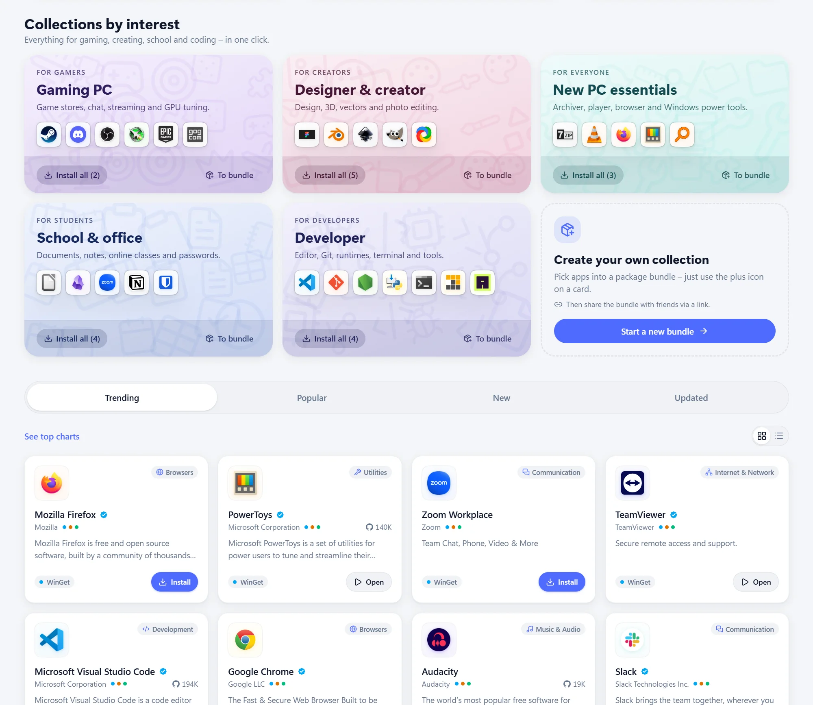
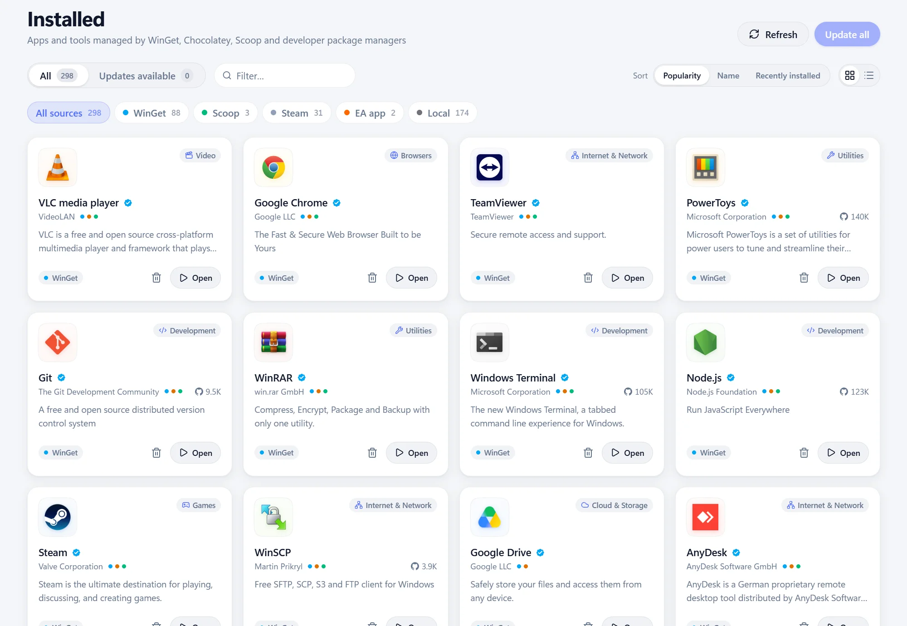

<div align="center">

**English** · [Čeština](README.cs.md)


# HubGet

### One store for every app on Windows

A modern app store for Windows 10 and 11. More than **25,000 apps** from the official
WinGet, Chocolatey and Scoop repositories – install them in one click, without hunting
for installers on the web, with no ads and no bundled extras.

[](LICENSE) [](#download) [](https://tauri.app) [](https://react.dev) [](#free-and-open-source)

**[⬇️ Download for Windows](https://github.com/matous96/HubGet/releases/latest)** &nbsp;·&nbsp; [🌐 hubget.eu](https://hubget.eu/en/index.html) &nbsp;·&nbsp; [Tour](#tour) &nbsp;·&nbsp; [Package managers](#package-managers) &nbsp;·&nbsp; [For developers](#for-developers)

<br>

<picture>
  <source media="(prefers-color-scheme: dark)" srcset="assets/readme/okno-tmave.webp">
  
</picture>

The Today page – tips, collections and the App of the Day. In seven languages (English, Czech, German, Spanish, French, Portuguese, Chinese), light and dark theme to match Windows.

</div>

## Why HubGet

| 🛡️ Safe – no viruses | ⚡ Simple | 🔄 Everything under control |
|:---|:---|:---|
| Only the official repositories of package managers. Every installer is verified against its SHA-256 checksum before it runs. | One click instead of setup wizards. No “Next, Next, Finish”, no bundled extras and no ads. | Updates and uninstalls for all your apps in one place – even the ones you installed earlier and some other way. |

One app = one card. When an app is available from several package managers, its card
shows every source with its version and you choose where to install it from.

## Tour

### Store and catalog

A **Today** home page with tips from hundreds of well-known apps and a new App of the Day
every day, categories, charts and collections for gamers, creators, students and
developers. Search with <kbd>Ctrl</kbd>+<kbd>K</kbd> covers the catalog and searches
package managers live; verified apps come first.

<picture>
  <source media="(prefers-color-scheme: dark)" srcset="website/img/screens/en/kolekce.webp">
  
</picture>

### App pages like in the App Store

A large banner in the colors of the app's icon, a screenshot gallery with a full-screen
viewer, what's new, ratings and reviews, privacy details and links to the website,
GitHub, documentation and support. Technical details: SHA-256, installer type, system
requirements and dependencies.

Install in one click from the source you choose, with download progress right on the app page.

<p align="center">
<picture>
  <source media="(prefers-color-scheme: dark)" srcset="assets/readme/stahovani-tmave.webp">
  
</picture>
</p>

### Installed apps and updates

An overview of every app on your computer – including programs installed outside WinGet,
Microsoft Store apps and games from Steam, Epic Games, EA app, GOG, Ubisoft Connect and
Battle.net. Install updates with one **Update all** button or
automatically on a schedule. When an operation fails because of permissions, HubGet
retries it with administrator rights by itself.

<picture>
  <source media="(prefers-color-scheme: dark)" srcset="website/img/screens/en/nainstalovane.webp">
  
</picture>

### And more

- 🧹 **Advanced uninstall** – finds what uninstallers leave behind (AppData, Program Files,
  the Start menu, the registry) and offers to delete it; with **install tracking** it
  removes exactly what the installer created.
- 🚀 **Startup apps** – programs that start when you sign in to Windows, in one place,
  with their impact on startup speed.
- ⏰ **Updates under control** – schedules for checks and installs, a minimum age for
  updates, battery exceptions and a warning when an installer comes from a different host.
- 📦 **Package bundles and profiles** – a shareable set of apps for a new PC, export for
  WinGet or as a PowerShell script.
- 💻 **Developer mode** – npm, Bun, pip, Cargo, vcpkg, .NET Tool and PowerShell for real,
  plus command-line commands ready to copy.
- ⭐ **Community** – sign in with GitHub, ratings, reviews and current screenshots from
  users; sync your favorites and preferences between computers.
- 🛡️ **Security updates first** – updates that fix a security issue get a red badge, come
  first and skip the minimum update age; developer packages are also checked against OSV.dev.
- 🔔 **Buttons in Windows notifications** – Update all, Open a newly installed app or see error Details.
- 💽 **Offline package** – put a bundle of apps on a USB drive with installers and an `install.cmd`
  script for a PC without internet.
- 🏷️ **“Install with HubGet” badge** for developers’ READMEs (app details → Share).
- 🏢 **Company policies** – Group Policy (ADMX template) and Intune: allowed package managers and
  approved apps, required updates, no sign-in.
- 👥 **Version reliability from the community** – opt-in and anonymous; automatic updates wait on
  a version that others roll back.
- 🔐 **App settings to a new PC** – in one file encrypted with your password.
- 📂 **What opens this file?** – drop a file onto the window (or search “.psd”) and HubGet offers
  apps that open it.
- 💾 **Disk space check** – an install that wouldn’t fit doesn’t start, and HubGet suggests a cleanup.
- 📜 **What’s new since your version** – release notes for every version an update skips.
- 🩺 **Diagnostics for support** and **Windows status** in PC overview (end of support, pending
  restart, disk space, restore points).
- 🔧 **Repair an app** – when an app won’t start or shows errors, HubGet restores its files
  from the installer (right-click the app → Repair).
- 🧽 **Preinstalled Windows apps** – remove Candy Crush, Solitaire, News, Tips and more in one
  click in PC overview; restore them any time from the Microsoft Store.
- ⚖️ **Compare apps** – up to four side by side: ratings, license, size, ARM64 support, install sources.
- ♿ **Accessibility** – text size that follows Windows, reduced motion, underlined links,
  Windows contrast themes and full keyboard control.
- 📥 **Manage with WinGet** – a program installed from the developer’s website that WinGet also has
  gets HubGet updates after one click; the program stays where it is.
- ✨ **New in catalog** – apps added to the catalog in the last 7, 30 or 90 days.
- 🔁 **Self-updating apps** (Chrome, Steam, Discord…) – their updates aren’t counted; HubGet only
  offers them when the app doesn’t update itself.
- 🏆 **Most installed in HubGet** – a chart of real installs over 30, 90 and 365 days
  (opt-in, anonymous).
- ✍️ **Installer signature check** – HubGet shows who signed the installer and won’t run a new
  version from a different publisher or without a signature.
- 🚧 **Abandoned apps** – a heads-up about apps that are no longer developed, with replacements.
- 🖥️ **New PC** – tick apps by category and HubGet installs them all at once.
- 🔌 **Drivers from Windows Update** – offered drivers in PC overview.
- 🔎 **Search by purpose** – “video editing”, “PDF reader” or “unzip” in Czech find the right apps.
- 💡 **Suggested apps and developer replies** – suggest a missing app and others vote; developers
  reply to reviews and see install statistics.
- 🎉 **Your year with HubGet** – a summary of installs, updates and time saved.
- ☁️ **Previously installed** – apps you’ve had before (on any of your PCs) show a cloud instead
  of Install; find them all in the Library and hide the ones you don’t want.
- 📤 **Offload app** – uninstalls an app but keeps its settings; they come back when you reinstall.
- ⏸️ **Pause downloads** – pause an installer download and resume it later.
- 🌟 **Major updates** – new major versions of your installed apps on Home.
- ⭐ **Rating prompt** – a one-click rating a few days after installing.
- 🔁 **Automatically from other PCs** – what you install elsewhere gets installed here too.
- 💡 **Recommended for you** – “Because you have OBS…” based on your installed apps, computed locally.
- 🧪 **Pre-releases** – try Beta, Insiders or Nightly builds from WinGet next to the stable app (like TestFlight).
- 🐢 **Download speed limit** – installers won’t saturate your connection.
- 💖 **Support the developers** – GitHub Sponsors, Open Collective, Ko-fi… links for open-source apps.
- ♻️ **Restore after reinstalling Windows** – HubGet recognizes the PC by name and brings its apps back.
- 🩺 **Why did the update fail?** – a guide finds what stopped it (programs holding files, services,
  pending restart, disk space, manifest) and fixes and retries it in one click.
- 🔁 **Retry failed** – after a batch of updates, only the ones that failed.
- 🌙 **Sleep or shut down when done** – next to Update all, with a countdown you can cancel.
- 🔑 **Finish at next sign-in** – before the apps that block the update start.
- 🐞 **Report a winget manifest problem** – a prefilled report for winget-pkgs.
- ⏸️ **Pause automatic updates** for 1, 3 or 7 days (before a presentation, say).
- 🧭 **Major versions manually only** – a new major version (OBS 32 → 33) waits for a click.
- 📋 **Overview before Update all** – what gets updated, from which version to which and how much
  is downloaded; untick individual apps.
- ⚡ **Download updates in advance** – installers for pending updates download in the background
  and the queue fetches the next two operations ahead, so it mostly just installs.
- ✅ **Post-update check** – the main program must be in place with a valid signature,
  otherwise a warning suggests rolling back.
- 🖥️ **Update your other PCs** – “Update there” in My computers; the other PC does it as soon as
  HubGet runs on it.
- 📲 **Install on another PC** – from the menu next to Install; the app is installed as soon as
  HubGet runs on that PC.
- 🌙 **Install later** – tonight, in an hour or at a chosen time; the PC won’t sleep until then.
- 🧪 **Try for a week** – if you don’t open the app once within a week, HubGet offers to uninstall it.
- 🕵️ **App privacy** – turn off telemetry in Firefox, Chrome, Edge, VS Code, Office, .NET and more
  using their official policies (PC overview and app details).
- 🛡️ **Defender installer scan** (optional) – Microsoft Defender fully scans a downloaded installer before it runs;
  if it finds something, the install doesn’t start.
- 🌙 **A modern window** in the Windows 11 style, light and dark theme, seven languages (English, Czech, German, Spanish, French, Portuguese, Chinese);
  close the window and installs finish in the background.

## Package managers

| Manager | Status | What it does |
|---|---|---|
| **WinGet** | ✅ fully working | search, install, update, uninstall and download installers |
| **Chocolatey** | ✅ fully working | search, install, update and uninstall; installs Chocolatey itself if it's missing |
| **Scoop** | ✅ fully working | no administrator rights needed; adds a missing Scoop, Git and buckets by itself |
| **npm, Bun, pip, Cargo, vcpkg, .NET Tool, PowerShell** | ✅ Developer mode | libraries and tools; installs a missing Node.js, Python or Rust via WinGet |

## Download

**[Download the latest version](https://github.com/matous96/HubGet/releases/latest)** –
the **EXE** installer installs for the current user without administrator rights, the
**MSI** suits company deployments. Requirements: Windows 10 or 11 (64-bit) and WebView2,
which comes preinstalled with Windows. HubGet then keeps itself up to date. More on the
website: [hubget.eu](https://hubget.eu/en/index.html).

> [!NOTE]
> The installer isn't digitally signed yet (signing through the SignPath Foundation is
> on the way). Edge may say the file "isn't commonly downloaded" (**… → Keep → Show more →
> Keep anyway**) and Windows SmartScreen shows a warning on the first run
> (**More info → Run anyway**).

## Free and open source

HubGet is free, with no ads and no telemetry, under the [MIT](LICENSE) license. The
catalog is generated every day on GitHub Actions; sign-in, ratings and sync run on the
free tier of Supabase. Signing in is optional – everything except ratings, reviews and
sync works without an account.

## For developers

Tauri 2 (Rust) + React 19 + TypeScript + Tailwind CSS v4 + Vite, with a data pipeline in
Node.js. Requirements: Node.js 24, pnpm 10 and, for the desktop app, Rust and Visual Studio
Build Tools with C++.

```bash
pnpm install
pnpm dev                # web version with sample data at http://localhost:1420
pnpm desktop            # desktop app (Tauri) with hot reload – one test version (org.unibox.dev, DevTools on port 9222), runs next to an installed HubGet
pnpm pipeline --local   # build the real catalog into public/catalog.json
pnpm typecheck          # type checks
```

| Folder | Contents |
|---|---|
| [`src/`](src) | React UI – pages, components, stores and services for package managers |
| [`src-tauri/`](src-tauri) | Rust backend – package manager engine, UAC, tray, updater, installer |
| [`data-pipeline/`](data-pipeline) | catalog generator from WinGet, Chocolatey and Scoop |
| [`supabase/migrations/`](supabase/migrations) | database for sign-in, ratings, reviews, screenshots and sync |
| [`website/`](website) | the project website (Czech and English) |
| [`.github/workflows/`](.github/workflows) | daily catalog, releases and Supabase maintenance |

### Code signing

`pnpm release` signs `unibox.exe`, the NSIS installer, its uninstaller and the MSI
automatically when a certificate is set in the environment. Tauri calls
[`scripts/sign.mjs`](scripts/sign.mjs) for each file (`bundle.windows.signCommand`), which
runs `signtool.exe` from the Windows SDK with SHA-256 and an RFC 3161 timestamp. Without a
certificate the build is unsigned and says so; a certificate that is set but can't be used
(wrong password, missing token) stops the build.

| Environment variable | Meaning |
|---|---|
| `UNIBOX_SIGN_PFX`, `UNIBOX_SIGN_PFX_PASSWORD` | a `.pfx` file with the certificate and key, and its password |
| `UNIBOX_SIGN_THUMBPRINT` | instead of a `.pfx`: the SHA-1 thumbprint of a certificate in the Windows store (Current User → Personal) – also a token or cloud HSM its driver exposes there |
| `UNIBOX_SIGN_TIMESTAMP_URL`, `UNIBOX_SIGNTOOL` | optional: another timestamp server, the path to `signtool.exe` |

**Local test certificate** – a self-signed code signing certificate for trying it out
(`signtool.exe` comes with the Windows SDK, e.g. "Windows 11 SDK" in Visual Studio Installer):

```powershell
pnpm sign:dev-cert   # creates %USERPROFILE%\.tauri\unibox-dev-signing.pfx and .cer, prints a password
$env:UNIBOX_SIGN_PFX = "$env:USERPROFILE\.tauri\unibox-dev-signing.pfx"
$env:UNIBOX_SIGN_PFX_PASSWORD = "<the printed password>"
pnpm release -- --no-bump   # signed build without changing the version
Get-AuthenticodeSignature .\src-tauri\target\release\bundle\nsis\*.exe | Format-List
```

Status `UnknownError` (untrusted root) is expected – Windows doesn't trust the certificate.
On a **test machine only** you can trust it, so UAC shows the publisher "HubGet (dev)":

```powershell
Import-Certificate -FilePath "$env:USERPROFILE\.tauri\unibox-dev-signing.cer" -CertStoreLocation Cert:\CurrentUser\Root
# after testing:
Get-ChildItem Cert:\CurrentUser\Root | Where-Object Subject -like 'CN=HubGet (dev)*' | Remove-Item
```

**SmartScreen while testing locally:** SmartScreen only checks files marked as downloaded
from the internet (Mark of the Web). An installer you built yourself has no mark, so
SmartScreen doesn't show up for it at all. For a copy you downloaded (from GitHub, through a
browser) and test on your own machine, `Unblock-File .\HubGet_<version>_x64-setup.exe`
removes the mark. Smart App Control in Windows 11 is a separate check – when it's on, it
may still block unsigned or self-signed builds. For other people, only a certificate from
a trusted authority plus reputation removes the warning (free for open source: SignPath
Foundation, see the Czech docs). Never distribute builds signed with the development
certificate. Certificates and passwords don't
belong in the repository (`.gitignore` skips `*.pfx`, `*.p12`, `*.key`).

The full developer documentation – Supabase setup, signing, releases, the catalog and
every app feature – is in Czech in [README.cs.md](README.cs.md#dokumentace-pro-vývojáře).
Issues and pull requests are welcome, including new translations
([`src/i18n/locales`](src/i18n/locales)).

## License

[MIT](LICENSE) © HubGet contributors
